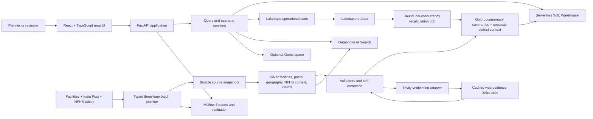

# Product Requirements Document: Medical Desert Planner

Status: Data-grounded draft for implementation
Date: 2026-07-19
Official mission: Medical Desert Planner
Target platform: Databricks Apps on Databricks Free Edition
Companion verification plan: `.omx/plans/test-spec-medical-desert-planner.md`
Authenticated data profile: `.omx/plans/data-profile-databricks-virtue-dais-2026.md`

## 1. Executive Decision

Medical Desert Planner is the single product.

The other challenge missions are not parallel products:

| Priority | Capability | Product role |
| --- | --- | --- |
| 1 | Medical Desert Planner | Official flagship mission and primary map-first workflow |
| 2 | Facility Trust Desk | Embedded facility drill-down inside the planner |
| 3 | Data Readiness Desk | Embedded human verification and correction loop |
| 4 | Referral Copilot | Feature-flagged extension only after the core release gates pass |

Stretch priorities:

| Priority | Capability | Decision |
| --- | --- | --- |
| P0 | Agentic Traceability | Core trust infrastructure |
| P0 | Self-Correction Loop | Core trust infrastructure |
| P1 | Dynamic Crisis Mapping | Main visual ambition after the core workflow is stable |
| P2 | Real-Impact Bonus | Delivered through the Verification Priority Queue |

The product must help a non-technical public-health or NGO planner answer:

> Where is nearby documentary support for a selected care capability weak, which areas also show relevant district survey concern, how certain is the result, and what evidence or data correction would most improve the decision?

The product must not claim real-time clinical availability, emergency readiness, healthcare supply, or a definitive medical desert from the available catalog. The MVP uses `low nearby documentary support`, `strong nearby documentary support`, `mixed evidence`, `insufficient corpus evidence`, and `planning-priority candidate`. The label `medical-desert candidate` remains disabled until an authorized population surface, a defensible facility-universe or registry-completeness assessment, operational-readiness assumptions, and a published capability-specific access policy are configured.

## 2. Product Vision

Build an operational field atlas for healthcare planning, not a generic dashboard and not a chatbot.

A planner selects a care capability and geography. The application summarizes nearby documentary evidence, separates low support from insufficient corpus evidence, optionally juxtaposes relevant NFHS-5 district survey context, exposes the facility evidence behind every result, allows a human to correct or qualify questionable records, and saves a reproducible planning scenario.

The central innovation is not another facility map. It is a traceable decision system that keeps six concepts separate:

1. What a source claims.
2. What the available evidence supports.
3. What is unknown or contradictory.
4. What facility records exist in the observed corpus.
5. What district survey context reports for a defined population and period.
6. What planning decision a human made.

## 3. Target Users and Pain

### 3.1 Primary user

NGO program planners, public-health planners, and humanitarian health operations analysts working at state, district, city, or PIN-code level in India.

### 3.2 Supporting users

| User | Job to be done | Current pain |
| --- | --- | --- |
| Planning analyst | Defend a geographic prioritization | Facility claims are hard to verify and aggregate |
| Data reviewer | Correct the records that matter most | Reviewing 10,000 records uniformly wastes scarce time |
| Program lead | Preserve decisions and assumptions | Analyses, notes, and corrections disappear after a session |
| Data engineer | Improve source quality without breaking lineage | Extracted facts lack durable evidence spans and versions |
| Optional referral coordinator | Build a plausible facility shortlist | A listed capability may not be operational or corroborated |

### 3.3 User pains

- Missing data can look like missing care.
- Facility descriptions mix claims, marketing language, and incomplete facts.
- Sparse fields such as doctor count and capacity cannot safely be interpreted as zero.
- A regional conclusion is not defensible unless it can be drilled down to exact evidence and excluded-record counts.
- A correction is not useful if downstream rankings do not update.
- Crisis maps can overstate certainty when the source is stale or simulated.

## 4. Goals and Non-Goals

### 4.1 Goals

- Deliver an end-to-end Medical Desert Planner on Databricks Apps.
- Conserve and disposition all 10,088 facility rows, 165,627 India Post office rows, and 706 NFHS-5 district rows.
- Produce canonical analytical entities from 9,989 distinct UUID-shaped facilities while preserving 88 quarantined spillover rows and 11 exact duplicate rows in lineage.
- Make every displayed conclusion traceable to source evidence or an explicit missing-data state.
- Distinguish strong or low nearby documentary support from insufficient corpus evidence.
- Show NFHS-5 indicators as a separate district survey-context layer, never as facility corroboration or a population denominator.
- Rank explicitly labeled planning-priority candidates without presenting them as proven medical deserts.
- Persist scenarios, notes, overrides, review decisions, and audit history.
- Demonstrate self-correction through deterministic validation and human review.
- Use MLflow 3 tracing for extraction, validation, retrieval, scoring, and orchestration.
- Use Tavily only where external corroboration materially improves a planning decision.
- Complete a reliable one-minute live demo.

### 4.2 Non-goals

- Building four equal challenge products.
- Patient-specific medical advice, diagnosis, triage, or emergency dispatch.
- Confirming real-time beds, clinicians, oxygen, opening hours, or patient acceptance.
- Treating a facility name, specialty inference, or missing field as verified fact.
- Replacing professional public-health planning or clinical judgment.
- Creating a general-purpose autonomous web research agent.
- Making Genie, Agent Bricks Supervisor, or Referral Copilot a critical-path dependency.
- Publishing raw model chain-of-thought.

## 5. Evaluation Strategy

The implementation backlog and demo script must mirror the judging rubric.

### 5.1 Evidence and Trust: 35%

Required proof:

- 100% of decision outputs have citations or say `insufficient evidence`.
- Any map cell can drill into contributing facilities.
- Any facility verdict can drill into exact source text, source field, URL, extraction date, and validation result.
- Machine assessment, human override, and final planning decision remain separate.
- Missing data never becomes negative evidence.
- A self-correction example visibly changes a facility verdict or regional uncertainty.

### 5.2 Product Judgment: 30%

Required proof:

- A non-technical user can complete the workflow without SQL or prompt writing.
- The map visually separates low nearby documentary support, strong nearby documentary support, mixed or contradictory evidence, insufficient corpus evidence, and unavailable analysis.
- NFHS-5 context is visually and semantically separate from facility documentary evidence.
- The Facility Trust Desk is available in every facility drill-down.
- The Verification Queue ranks records by decision impact, not generic data-quality severity.
- A scenario can be saved, reopened, and compared with current data.

### 5.3 Technical Execution: 25%

Required proof:

- Live Databricks App on Free Edition.
- Serverless SQL and Delta tables provide the primary analytical read path.
- Lakebase preserves operational state across app restarts.
- MLflow traces correlate a user result with extraction, scoring, retrieval, and persistence spans.
- Failure states degrade honestly without fabricated results.
- The application remains responsive on the full dataset.

### 5.4 Ambition: 10%

Required proof:

- P0 traceability and self-correction work end to end.
- P1 crisis mode creates a compelling, source-labeled map transformation.
- P2 a review decision changes a high-impact regional result or uncertainty band.
- Referral Copilot is shown only if all earlier release gates remain green.

## 6. Product Vocabulary and Safety Semantics

These terms are product contracts.

| Term | Meaning |
| --- | --- |
| Claim | A statement present in a source field or external source |
| Evidence span | Exact text, image reference, or structured field supporting a claim |
| Corroborated | Supported by direct evidence from at least two qualifying independent source families |
| Claim-only | Present in a source but weakly supported or uncorroborated |
| Contradicted | Conflicts with another source, prerequisite rule, or reviewer decision |
| Insufficient evidence | No defensible positive or negative conclusion |
| Documentary support index | Ordinal evidence quality for one facility-capability assertion; not operational readiness or capacity |
| Observed record assessability | Whether observed corpus records can be structurally parsed, geographically resolved, traced, and assessed |
| Insufficient corpus evidence | The observed corpus is too incomplete, stale, malformed, ambiguous, or unverifiable to support a regional documentary conclusion; it does not claim the real facility universe is empty |
| Low nearby documentary support | Few nearby observed facility records have qualifying documentary support under explicit scenario assumptions |
| Strong nearby documentary support | One or more nearby observed facility records have qualifying documentary support; it does not prove capacity or availability |
| District survey context | An NFHS-5 estimate for a defined district population, period, and sample; it is not a population count or facility-demand quantity |
| Postal reference point | A derived reference from valid post-office coordinates for one PIN; it is not a PIN centroid, boundary, settlement center, or population origin |
| Planning-priority candidate | A review or planning candidate created from low documentary support, adequate assessability, and separately displayed context signals; external validation is required |
| Medical-desert candidate | A future service-access deficit candidate requiring population, operational-supply, completeness, capacity, and published access-policy inputs not present in the current catalog |
| Policy-verified assertion | A human or automated policy accepted an assertion for a stated time and use based on qualifying evidence; it is not guaranteed operational truth |
| Override | A reversible human decision that does not erase the machine result |

The application must display a persistent boundary:

> Planning support only. Facility capabilities may be incomplete or stale. Do not use this application for emergency dispatch, diagnosis, or confirmation of current service availability.

## 7. MVP Workflow

### 7.1 Planner flow

1. The user opens the Planner.
2. The user selects a care capability.
3. The user selects a state, district, city, PIN, or map area.
4. The user optionally changes a clearly labeled planning radius.
5. The app loads a precomputed regional documentary evidence summary and observed record assessability.
6. The map and synchronized result list rank low-nearby-documentary-support and planning-priority candidates.
7. The user selects a region or map cell.
8. The right rail explains what is documented, unknown, contradicted, excluded, and separately reported by NFHS-5.
9. The user opens a facility.
10. Facility Trust Desk shows capability-specific documentary support and the complete decision trace.
11. The user adds a note, records an override, or sends the facility to the Verification Queue.
12. The user saves a scenario containing filters, map extent, assumptions, facilities, notes, score versions, and evidence snapshot identifiers.
13. Reopening a scenario restores the original result and shows what changed since it was saved.

### 7.2 Data Readiness flow

1. A reviewer opens the Verification Queue.
2. Items are ranked by expected impact on active scenarios and the regional documentary-summary state.
3. The reviewer inspects the evidence, validation flags, and optional Tavily corroboration.
4. The reviewer chooses confirm, correct, defer, unresolved, or attach-source.
5. The original machine result remains visible.
6. The current read model is recalculated.
7. Affected scenarios receive a `result changed` notification while their saved snapshots remain immutable.

### 7.3 Optional Referral Copilot flow

Referral Copilot is available only behind a feature flag after Gate G7.

It accepts a location and care need, then produces a shortlist of plausible facilities with:

- Evidence-supported capability.
- Straight-line distance or an explicitly sourced travel-time estimate.
- Data gaps and contradictions.
- Freshness label.
- A prominent statement that availability must be confirmed outside the app.

## 8. Functional Requirements

### FR-1 Capability and geography selection

- Support capability search and controlled vocabulary.
- Support state, district, strict six-digit PIN, and map selection.
- Enable city selection only after measured normalization quality is accepted in G1.
- Preserve geography when switching capability.
- Preserve capability when drilling between geographic levels.
- Expose the scenario assumptions used for classification.

### FR-2 Evidence-weighted map

- Render precomputed `analysis_origin` results as PIN-reference points, an approved H3/tessellation layer, or externally sourced district geometry, with facility points as evidence overlays.
- Provide a synchronized sortable table as a non-map alternative.
- Use local GeoJSON or preloaded geometry; do not make external map tiles a demo dependency.
- Never encode meaning by color alone.
- Distinguish:
  - strong nearby documentary support;
  - low nearby documentary support;
  - low documentary support requiring external validation;
  - mixed or contradictory signal;
  - insufficient corpus evidence;
  - unavailable analysis.
- Render NFHS district survey context as a separate layer, panel, hatch, or secondary encoding that cannot be mistaken for facility evidence.
- Label postal reference points and their ambiguity or dispersion; never call them PIN centroids.

### FR-3 Facility Trust Desk

For a selected capability, show:

- Machine verdict.
- Human-reviewed verdict, if any.
- Evidence sufficiency and decision-readiness band.
- Exact evidence spans.
- Source field and URL.
- Publisher, source family, publication time, valid time, and retrieval time where known.
- Extraction method and version.
- Entity-attribution confidence.
- Corroborating signals.
- Contradictions.
- Missing prerequisites.
- Freshness.
- Score factors and rule version.
- Review and override history.

Do not show a universal facility trust score as if it applies to all capabilities.

### FR-4 Agentic traceability

Persist the following multi-input lineage:

`source bundle -> source row -> integrity/parse disposition -> evidence span -> normalized claim -> validator findings -> score factors -> facility result -> geography/crosswalk contribution -> regional documentary summary -> displayed result`

NFHS context lineage is separate:

`NFHS source row -> raw indicator -> parsed value + qualifier -> district crosswalk -> district context panel`

Each step must carry:

- Stable identifier.
- Timestamp.
- software, prompt, model, rule, and configuration version where applicable.
- Input and output references.
- Status and error information.
- MLflow trace and span identifiers.

### FR-5 Self-correction loop

- Run deterministic validators before publishing a facility verdict.
- Validators must detect at least:
  - structurally shifted or spillover facility rows;
  - malformed JSON-like fields without converting them to empty evidence;
  - duplicate UUID rows and repeated post-office rows;
  - duplicate evidence counted as corroboration;
  - organization or facility cross-attribution;
  - specialty inferred only from a facility name;
  - capability claims with missing configured prerequisites;
  - contradictory capacity or clinician counts;
  - malformed geography;
  - zero, `NA`, or out-of-range post-office coordinates;
  - ambiguous PIN-to-district mappings and join-cardinality multiplication;
  - NFHS suppression or low-sample qualifiers being discarded;
  - stale or inaccessible sources;
  - external evidence that does not name the facility.
- A failed validator lowers support, widens uncertainty, or abstains.
- Human review can confirm, correct, or leave unresolved.
- All changes are reversible and auditable.

### FR-6 Verification Priority Queue

Queue items include:

- Questionable claim or field.
- Why it matters.
- Affected capabilities, map cells, regions, and scenarios.
- Expected decision impact.
- Existing evidence.
- Optional Tavily evidence.
- Recommended review action.
- Owner, status, and age.

Initial priority formula, versioned in configuration:

```text
priority =
  0.40 * classification_flip_potential
+ 0.25 * map_cells_or_regions_affected
+ 0.20 * active_scenario_references
+ 0.10 * evidence_staleness
+ 0.05 * unresolved_contradiction_severity
```

When an authorized population denominator is added, replace the region-count proxy with estimated affected population.

### FR-7 Scenario persistence

A scenario stores:

- Name, owner, collaborators, and timestamps.
- Capability and geography filters.
- Coverage radius and all planning assumptions.
- Map extent and selected regions.
- Shortlisted facilities.
- Notes and decision rationale.
- Machine score version.
- Human review version.
- Dataset snapshot and evidence snapshot identifiers.
- Current-vs-saved change summary.

Use optimistic concurrency and immutable audit events.

Authorization:

- Planners can create and update owned or shared scenarios.
- Reviewers can decide verification items and issue evidence-backed overrides.
- Administrators manage role mappings and policy configuration.
- Single-team demo mode disables collaboration if trusted per-user identity is unavailable.

Supported authorization profiles:

| Profile | Behavior |
| --- | --- |
| Full identity/RBAC | Trusted per-user identity, owner/collaborator checks, Planner/Reviewer/Administrator roles, multi-user isolation |
| Single-team demo | One fixed trusted actor, collaboration hidden, alternate identities rejected, no claim of multi-user isolation |

### FR-8 Crisis mode

Crisis mode is P1, not an MVP dependency.

- Accept an uploaded or preloaded affected-area geometry and incident metadata.
- Label the source as live, uploaded, or demo.
- Show source time and last refresh.
- Overlay documentary facility evidence, unresolved facilities, insufficient corpus evidence, and the incident geometry.
- Produce a short, evidence-linked planning summary.
- If live incident data is unavailable, use an explicitly labeled demo scenario.

### FR-9 Exports

- Export a scenario summary as JSON and CSV.
- Export a human-readable decision brief after the core app is stable.
- Include assumptions, citations, and uncertainty language.
- Never export hidden chain-of-thought.

## 9. Trust, Uncertainty, and Documentary Evidence Model

### 9.1 Design principle

Documentary support, contradiction, observed record assessability, postal-reference distance, and district survey context are separate measures.

Do not treat an internal score as a calibrated probability until it has been tested against an adjudicated evaluation set.

### 9.2 Facility capability support

Initial deterministic documentary-support strategy:

```text
documentary_support_index =
  direct_evidence_specificity       # 0..30
+ independent_source_corroboration  # 0..20
+ source_quality                    # 0..15
+ entity_attribution_quality        # 0..15
+ freshness                         # 0..10
+ prerequisite_support              # 0..10
```

Rules:

- Clamp to 0..100.
- Duplicate text and multiple fields derived from one page or publisher family are one source family, not independent corroboration.
- Missing data reduces assessability; it is not a contradiction.
- Facility-name heuristics can suggest a review candidate but cannot create a supported capability.
- Capacity and doctor count are optional positive signals, never assumed zero.
- Human override is stored separately and can supersede the displayed verdict only with a cited reason.
- The documentary support index is an ordinal decision aid unless it is calibrated against an independently adjudicated sample.
- A supported assertion is not proof that the service is currently staffed, functioning, or accepting patients.
- `contradiction_state = none | unresolved | confirmed` is stored and displayed separately.
- An unresolved contradiction can force abstention or a policy cap, but it is never hidden inside an opaque numeric deduction.
- A confirmed contradiction displays `contradicted` while preserving the original support factors and cited counterevidence.

Initial bands:

| Internal score | Display band |
| --- | --- |
| 75-100 | Strongly supported |
| 50-74 | Partially supported |
| 25-49 | Claim-only or weak |
| 0-24 | Unsupported or very weak |
| Not scoreable | Insufficient evidence |

The UI displays the band, contradiction state, and factor breakdown more prominently than the number.

### 9.3 Observed record assessability

The MVP measures `observed_record_assessability`, not completeness of the real facility universe.

Required counts:

- `N_source_rows` is the physical source-row count preserved in bronze.
- `N_structurally_eligible_rows` excludes the 88 quarantined spillover rows but preserves them in lineage.
- `N_canonical_facility_entities` is the distinct valid facility count after collapsing the 11 exact duplicate rows.
- `N_region_entities` is the count of distinct canonical facilities assigned to the selected geography through an accepted mapping.
- `N_capability_assessed_entities` is the subset with a completed capability assessment.
- The formula makes no claim about facilities absent from the dataset.
- Quarantined, malformed, or unassigned rows cannot contribute positive or negative capability evidence.
- If `N_region_entities=0`, return `no observed records` and classify the result as insufficient corpus evidence, never as missing care.

Initial versioned formula:

```text
observed_record_assessability = clamp(
  0,
  1,
  0.15 * source_structural_integrity_rate
+ 0.25 * geography_resolution_rate
+ 0.20 * traceable_source_rate
+ 0.20 * capability_assessment_completion_rate
+ 0.10 * entity_resolution_rate
+ 0.10 * freshness_known_rate
- 0.15 * unresolved_contradiction_rate
- 0.15 * ambiguous_geography_rate
)
```

Every component declares its numerator, denominator, excluded count, and source-bundle version. Region rates use `N_region_entities` unless the component is explicitly source-global.

The UI term and internal status code are `insufficient corpus evidence` and `insufficient_corpus_evidence`.

NFHS and district-crosswalk coverage are excluded from this formula. A separate `survey_context_availability` measure reports whether district survey context is matched, crosswalked, ambiguous, unmatched, or unavailable. Removing NFHS input must not change facility documentary support, observed record assessability, or the regional documentary classification.

### 9.4 Regional documentary summary and future access mode

The MVP regional result is a documentary evidence summary, not healthcare supply, capacity, or a clinical access standard.

- Create one `analysis_origin` per distinct PIN independently of facility presence. Retain all 19,586 PIN origins; 19,550 have at least one valid postal coordinate and 36 remain unavailable with a reason.
- Derive one optional `postal_reference_point` per PIN from valid post-office coordinates using a versioned median or medoid rule, and retain office count, coordinate dispersion, state/district candidates, and ambiguity.
- A versioned external tessellation or H3 origin universe may replace or augment postal origins only after G1 comparison tests. H3 cells derived only from facility points may be rendered as evidence density, but cannot define where the planner evaluates low support.
- Use a district choropleth only when an external versioned boundary asset and reviewed temporal/name crosswalk are present.
- Precompute an `analysis_origin_facility_distance` table for origin-facility pairs within the maximum supported radius.
- Support only the versioned straight-line radius presets `10 km`, `25 km`, and `50 km` in the MVP.
- At query time, filter the precomputed distance table by the selected preset and summarize distinct canonical facilities.
- Report counts by documentary support band, contradiction state, excluded reason, and nearest qualifying facility-record distance.
- Do not sum documentary support as though it were supply capacity.
- Preserve the facility list and contribution reason behind every summary.
- Treat the radius preset as a scenario assumption, not a medical standard.
- Label straight-line distance explicitly.

Dataset-only classification matrix:

| Nearby documentary support | Observed record assessability | Result |
| --- | --- | --- |
| Low | High | Low nearby documentary support; external validation required |
| Low | Low | Insufficient corpus evidence |
| High | High | Strong nearby documentary support |
| High | Low | Mixed signal; verification required |

NFHS-5 indicators appear on a separate `district survey context` axis. They may sort a versioned `planning-priority candidate` queue only when the selected indicator policy documents relevance to the selected capability, qualifier handling, survey period, and limitations. The UI must show documentary evidence and survey context as separate components rather than one opaque desert score.

Initial thresholds are configuration, not hard-coded clinical truth. The assessability formula, radius presets, geography cell type, postal-reference method, district crosswalk, and thresholds must be frozen in G1 and versioned.

Future access-enriched mode may label a region `medical-desert candidate` only when all of the following are present:

- Authorized population surface or denominator.
- Defensible facility-universe or registry-completeness assessment.
- Current operational-readiness evidence or explicitly modeled uncertainty.
- Published capability-specific access policy.
- Explicit distance or travel-time method.
- Capability-specific capacity assumptions stated as observed, estimated, or unknown.
- Documentary evidence and observed record assessability above configured minimums.
- A declared relationship between any survey indicator and the selected capability.

Service deficit and data deficit remain independent axes and can coexist.

### 9.5 Calibration without ground truth

- Build a stratified expert-reviewed fixture set.
- Measure extraction precision, citation accuracy, ranking agreement, and abstention.
- Use perturbation tests to verify monotonic behavior.
- Report score stability and agreement with proxy labels.
- Do not claim true probability calibration from the challenge dataset alone.

## 10. UX and Information Architecture

### 10.1 Navigation

- Planner
- Scenarios
- Verification Queue
- Referral, hidden until enabled

Facility Trust Desk is a drill-down panel, not a separate top-level page.

### 10.2 Visual direction

The application should feel like a calm operational atlas:

- Map-first canvas.
- Compact controls.
- Dense but legible evidence panels.
- No decorative marketing hero.
- No chat-first interaction.
- No generic card grid.

Suggested visual semantics:

| State | Visual treatment |
| --- | --- |
| Strong nearby documentary support | Teal fill or marker |
| Low nearby documentary support | Coral fill with solid boundary |
| External validation required | Coral hatch |
| Insufficient corpus evidence | Slate stipple |
| Mixed signal | Ochre boundary |
| NFHS survey-context concern | Separate hatch, side panel, or secondary legend |
| Selected area | Strong ink outline |

All states also require text labels, icons, or patterns.

### 10.3 Accessibility

- WCAG 2.2 AA target.
- Complete keyboard workflow.
- Sortable table equivalent for map results.
- Visible focus.
- Reduced-motion mode.
- Screen-reader summary on map selection changes.
- No color-only meaning.
- Mobile layout supports review and scenario access; map authoring may prioritize tablet and desktop.

### 10.4 One-minute demo

The demo starts on a prepared geography with no crisis-mode dependency.

| Time | Action and narration |
| --- | --- |
| 0:00-0:08 | "Medical Desert Planner helps an NGO planner prioritize validation without mistaking missing documentation for missing care." |
| 0:08-0:20 | Select `maternal_emergency_documentation` and open the prepared Darbhanga, Bihar analysis. Point to low nearby documentary support and the separate NFHS maternal survey-context panel. |
| 0:20-0:34 | Open a prepared facility. Show the exact source sentence, source family, documentary support band, contradiction state, and missing-policy flag. |
| 0:34-0:44 | Reveal or apply a prepared review decision. Show immediate facility read-your-write and the regional `update pending` or applied state. |
| 0:44-0:52 | Save the scenario. Point to the trace ID and state that Delta/Serverless SQL serves the map, Lakebase preserves decisions, and MLflow records the evidence workflow. |
| 0:52-1:00 | State the key tradeoff: "This is a planning-priority candidate, not proof of a medical desert or current operational capability. Unknown documentation stays unknown, never no." |

Required rehearsal result: 10/10 complete runs at 60 seconds or less. Target: 20/20, median 52 seconds or less.

## 11. Architecture Decision

### 11.1 Options considered

#### Option A: Streamlit monolith

Advantages:

- Fastest route to a deployed Databricks App.
- Python-only development.
- Good fit for analytics and forms.

Disadvantages:

- Harder to deliver a polished map-first workspace.
- More rerun and state-management complexity.
- Facility drawer, scenario comparison, and dense map interactions are less controllable.

Use as the explicit fallback if fewer than two implementers are available or less than 48 focused hours remain.

#### Option B: React + FastAPI in one Databricks App

Advantages:

- Best fit for the flagship visual map.
- Clear separation between UI, domain logic, and data adapters.
- Better control of interaction, accessibility, caching, and progressive loading.
- Still deploys as one Databricks App.

Disadvantages:

- Requires frontend build tooling.
- More integration and deployment work.
- Requires a verified root build and Python startup contract.

#### Option C: Dash monolith

Advantages:

- Python-first with stronger UI control than basic Streamlit.

Disadvantages:

- Smaller contributor familiarity.
- Less flexible than React for the intended evidence and map workflow.

### 11.2 Decision

Choose Option B: React + TypeScript frontend and FastAPI/Python backend in one Databricks App.

Fallback trigger:

- Switch to Option A if any of these is true at the end of Stage 0:
  - the root frontend build cannot complete reproducibly in the Databricks deployment;
  - the React shell cannot call one typed FastAPI endpoint in the deployed App;
  - the team has fewer than two implementers and less than 48 focused hours remain;
  - two consecutive vertical-canary deployments fail for frontend integration reasons.

Fallback feature matrix:

| Capability | React + FastAPI | Streamlit adapter |
| --- | --- | --- |
| Core planner filters and ranking | Full | Full |
| Facility evidence and review | Full | Full |
| Scenario persistence | Full | Full |
| Accessible result table | Full | Full |
| Rich map interactions and comparison | Full | Reduced |
| Crisis animation | Optional full experience | Static or reduced |

The fallback reuses the same application services, repositories, scoring, and contracts. It replaces only the presentation adapter.

### 11.3 Architecture pattern

Use a lightweight hexagonal architecture:

- Domain layer contains claims, evidence, scoring, scenarios, and review rules.
- Application services orchestrate use cases.
- Ports define analytics, state, model, search, Tavily, and tracing interfaces.
- Adapters implement Databricks SQL, Lakebase, AI Search, Foundation Model API, Tavily, and MLflow.
- API layer is FastAPI.
- React consumes typed REST endpoints.

Additional patterns:

- Repository pattern for Delta and Lakebase access.
- Strategy pattern for capability-specific prerequisites and scoring.
- Adapter pattern for external services.
- Pipeline stage pattern with typed Pydantic contracts.
- CQRS-like split: Delta gold tables are analytical read models; Lakebase is operational write state.
- Transactional outbox pattern for review propagation.
- Single-writer materialization for review-driven Delta updates.
- Immutable audit event log.
- Configuration as code for capabilities, scoring, and thresholds.

## 12. System Architecture



### 12.1 Databricks resources

Required:

- One Databricks App.
- One 2X-Small serverless SQL warehouse.
- Unity Catalog tables and views.
- One Lakebase Autoscaling project.
- One MLflow experiment.
- App service principal with least privilege.
- Secret resource for Tavily.

Conditional:

- One AI Search endpoint with a Delta Sync index.
- One pay-per-token Foundation Model API endpoint available in the workspace.
- One Genie space over curated gold tables.

Not critical path:

- Agent Bricks Knowledge Assistant, unsupported in Free Edition.
- Agent Bricks Supervisor, currently a higher-risk preview/beta dependency.
- Direct Vector Access, unsupported in Free Edition.

### 12.2 App runtime

- Python 3.11 FastAPI server.
- React static build served by FastAPI.
- Use the Databricks Apps `DATABRICKS_APP_PORT` environment variable.
- Bind resources and reference them through `valueFrom` in `app.yaml`.
- Use app authorization and the app service principal; do not hard-code PATs.

Build and start contract:

- Root `package.json` is private, declares `workspaces: ["frontend"]`, and is the only npm workspace root.
- Commit one root `package-lock.json`; do not create a second frontend lockfile.
- All packages required during the Databricks production build, including Vite and TypeScript tooling, are available to the root build installation.
- `npm ci` performs the frozen Node install.
- `npm run build` runs the frontend workspace production build.
- Vite writes static assets into `src/medical_desert/api/static`.
- Commit `pyproject.toml` and `uv.lock`.
- `uv sync --frozen` performs the frozen Python install.
- Pin `mlflow==3.14.0` for the hackathon release and lock all direct and transitive Python dependencies.
- `scripts/package_app.py --adapter react|streamlit` creates a deterministic deployment source root under `.dist/`.
- `.dist/react-app` contains the Python package, React workspace, root Node manifests, Python manifests, and React `app.yaml`.
- `.dist/streamlit-app` contains the Python package, `streamlit_app.py`, Python manifests, and Streamlit `app.yaml`.
- `.dist/streamlit-app` must exclude `package.json`, `package-lock.json`, `frontend/`, and all Node build artifacts.
- The Databricks deployment command points to the selected `.dist/<adapter>-app` source root, never the repository root.
- The selected artifact's `app.yaml` starts its Python entrypoint, not a shell pipeline.
- The React Python entrypoint reads `DATABRICKS_APP_PORT` and starts Uvicorn.
- The Streamlit Python launcher reads `DATABRICKS_APP_PORT` and invokes Streamlit for `streamlit_app.py`.
- Stage 0 proves packaging, artifact-content validation, build, and start using the exact selected source root.

### 12.3 Authentication and authorization

Resource authentication and user authorization are separate:

- The App service principal accesses Databricks resources with least privilege.
- The backend extracts the authenticated Databricks actor only from a platform-trusted identity mechanism validated during Stage 0.
- An internal Lakebase role map controls product actions.

Roles:

| Role | Permissions |
| --- | --- |
| Planner | Read analytics, create and update owned scenarios, add notes, submit verification items |
| Reviewer | Planner permissions plus decide verification items and create evidence-backed overrides |
| Administrator | Manage role mappings, policies, and override expiry; cannot erase audit history |

Authorization rules:

- Scenario owner and explicit collaborators can read or update a private scenario.
- Review actions require Reviewer or Administrator.
- Every write stores actor, role, request ID, and timestamp.
- Resource grants do not imply product-role grants.
- If trusted per-user identity is not available in the target Free Edition App, the demo runs in documented single-team mode with one fixed trusted actor, collaboration is disabled, and the application does not claim multi-user isolation.

## 13. Data Architecture

### 13.1 Source constraints

Authenticated inspection on 2026-07-19 verified one Delta Sharing catalog, one data schema, and three source tables:

| Source table | Grain | Rows | Columns | Permissible role |
| --- | --- | ---: | ---: | --- |
| `facilities` | Extracted facility source row | 10,088 | 51 | Facility documentary evidence and point geography |
| `india_post_pincode_directory` | India Post office | 165,627 | 11 | Postal-office references and administrative labels |
| `nfhs_5_district_health_indicators` | NFHS-5 state/district factsheet row | 706 | 109 | District survey context and sample metadata |

Verified facility integrity:

- 10,000 UUID-shaped rows.
- 9,989 distinct valid facility IDs.
- 11 exact duplicate rows beyond the first occurrence.
- 88 non-UUID spillover or column-shifted rows that must be preserved and quarantined.
- JSON-like arrays are stored as strings.
- 99.6% of UUID-shaped rows have coordinates inside a broad India bounding box.
- 97.7% have a strict six-digit PIN string.
- Only 35.4% have a parseable page-update date.

Verified postal-directory constraints:

- 19,586 distinct PIN values.
- Average 8.46 office rows per PIN; maximum 153.
- 12,015 nonnumeric coordinate rows and 13 zero-coordinate rows.
- 290 PINs span multiple state labels and 1,478 span multiple district labels.
- The table contains post-office points, not PIN centroids, PIN polygons, settlements, or population origins.

Verified NFHS constraints:

- 706 unique normalized state/district rows and 36 states or union territories.
- 704 district values require outer-whitespace trimming.
- 49 indicator columns use string encoding for numerics and survey qualifiers.
- Parentheses mean 25-49 unweighted cases; `*` means the percentage is suppressed because it is based on fewer than 25 unweighted cases.
- The table contains survey estimates and sample counts, but no district population, boundary geometry, confidence intervals, or facility-demand quantity.

Strict cross-source join coverage:

- 9,766 valid facility PINs.
- 9,568 match the postal directory.
- 9,055 reach a PIN with one state and one district label.
- 5,862 reach NFHS through an exact normalized state/district match.

The authoritative profiling artifact is `.omx/plans/data-profile-databricks-virtue-dais-2026.md`.

### 13.2 Bronze

`source_bundle_manifest`

- One immutable identifier for the three-table input bundle.
- Source catalog, schema, table, schema fingerprint, row count, ingestion timestamp, and upstream snapshot metadata.
- Required count contract for this snapshot: `10,088`, `165,627`, and `706`.

`facility_source_snapshot`

- Exact copy of source values.
- Stable `source_row_id`.
- `source_table`.
- `source_bundle_id`.
- `ingested_at`.
- No destructive normalization.

`india_post_office_snapshot`

- Exact copy of all 165,627 post-office rows.
- Stable `source_row_id`.
- PIN is preserved and also normalized to a six-character string in silver.

`nfhs5_district_snapshot`

- Exact copy of all 706 district rows.
- Raw indicator strings, whitespace, parentheses, and asterisks remain recoverable.
- No destructive numeric coercion.

### 13.3 Silver

| Table | Purpose |
| --- | --- |
| `facility_row_integrity` | Source-row structural status, UUID validation, column-domain checks, quarantine reason, parser status, and source-row hash |
| `facility_entity` | One canonical facility entity per valid UUID after deterministic exact-duplicate collapse, with all source-row lineage retained |
| `facility_normalized` | Canonical facility, contact, address, geography, and entity-resolution fields |
| `facility_field_parse` | Raw JSON-like value, parsed value, parser version, parse status, and field-level quality flags |
| `source_artifact` | Publisher, source family, URL/document/image, publication time, retrieval time, and content hash |
| `facility_claim` | One row per facility, capability, claim type, polarity, scope, and valid time |
| `extraction_assertion` | Extracted interpretation with model/prompt version and extraction confidence |
| `evidence_span` | Exact text or image reference with source offsets and provenance |
| `evidence_relation` | Supports or refutes, directness, independence group, freshness, and scope |
| `facility_quality_signal` | Missingness, malformed values, duplicates, contradictions, and attribution risks |
| `web_evidence` | Cached Tavily results and extracted passages |
| `claim_validation` | Rule/model validator outcomes and versions |
| `postal_office_normalized` | Parsed office coordinates, validity, normalized administrative labels, and duplicate classification |
| `pin_postal_reference` | One row per PIN with office count, coordinate method, valid-coordinate count, dispersion, label candidates, and ambiguity status |
| `analysis_origin` | One facility-independent evaluation origin per PIN or approved tessellation cell, with origin method, mappability, unavailability reason, and version |
| `district_identity_crosswalk` | Versioned source names, canonical state/district keys, temporal frame, match method, confidence, and review status |
| `nfhs_indicator_observation` | Long-form indicator, raw value, numeric value, unit, qualifier, parse status, sample metadata, and survey period |
| `district_survey_context` | Approved district context indicators with policy version and no facility-score contribution |
| `geography_dimension` | State, district, city where accepted, PIN, facility point, postal reference point, optional external geometry, and H3 cell |
| `capability_dimension` | Controlled capabilities, synonyms, prerequisites, and scenario defaults |

### 13.4 Gold

| Table or view | Purpose |
| --- | --- |
| `facility_documentary_support` | Capability-specific documentary support index, band, contradiction state, factors, uncertainty, and materialized review version |
| `regional_documentary_evidence_summary` | Distinct observed facilities by support band, contradiction, exclusion reason, nearest qualifying distance, and assessability |
| `analysis_origin_facility_distance` | Precomputed straight-line origin-facility edges within 50 km |
| `district_context_profile` | NFHS indicators, qualifiers, and `survey_context_availability` joined through the versioned district crosswalk |
| `planning_priority_candidate` | Separate documentary-support and survey-context axes with a visible sorting policy and external-validation requirement |
| `verification_priority` | Impact-ranked human review queue |
| `facility_evidence_document` | Search-ready evidence documents for Delta Sync AI Search |
| `scenario_change_feed` | Material changes that affect saved scenarios |

### 13.5 Lakebase

Operational tables:

- `planning_scenario`
- `scenario_region`
- `scenario_facility`
- `planner_note`
- `facility_override`
- `review_decision`
- `saved_shortlist`
- `audit_event`
- `idempotency_key`
- `outbox_event`
- `stage_run`
- `materialization_checkpoint`

Authority contract:

- Lakebase is authoritative for commands, scenarios, notes, review decisions, overrides, audit events, outbox events, and job status.
- Delta bronze and silver are authoritative for preserved source data and derived evidence artifacts.
- Delta gold is strictly derived. It may materialize review effects, but it never becomes the authoritative store for the review command itself.

Review propagation protocol:

1. One Lakebase transaction writes the review decision, immutable audit event, and outbox event.
2. The API returns `accepted` with `command_version`, `review_version`, and `materialization_state=pending`.
3. The App triggers the bound recalculation Job after commit; a scheduled backup run drains missed events.
4. The Job claims events in sequence within a `stream_key`, records a `stage_run`, and processes each event idempotently.
5. The Job merges the derived review version into affected facility, regional, queue, and scenario-change Delta tables.
6. A materialization checkpoint per `stream_key` records the highest applied event sequence and output snapshot.
7. The Job marks the outbox event `applied` or `failed_final` with diagnostic metadata.
8. The UI polls materialization state and shows pending, applied, or failed.

Consistency behavior:

- Facility review panels read the committed Lakebase decision immediately, providing read-your-write behavior.
- Map and regional aggregates are eventually consistent and display their materialized review version.
- The UI never silently mixes a newer review with an older aggregate; version mismatch displays `update pending`.
- Failed events remain replayable by idempotency key and sequence.
- `stream_key` is the smallest causal unit, normally the facility ID; policy-wide events use an explicit policy stream.
- A `failed_final` event is quarantined and blocks later events only in the same stream.
- Later events in that stream become `blocked_dependency`; events in other streams continue.
- A Reviewer or Administrator can repair and replay the failed event, or an Administrator can issue an audited supersession event.
- A superseded poison event advances the stream checkpoint only with the supersession audit reference.
- Outbox processing is single-writer with maximum one concurrent Job run to preserve deterministic ordering.
- A committed review is never rolled back because materialization failed.

### 13.6 Efficient storage and retrieval

- Use structured SQL for maps, rankings, filters, and facility drill-down.
- Precompute regional documentary summaries, district context profiles, and queue priority; do not run agent workflows for every map interaction.
- Use Liquid Clustering or another measured optimization only on high-value filter keys; do not over-partition 9,989 canonical facilities, 19,586 PIN references, or 706 district profiles.
- Convert NFHS from wide source form to a long indicator table for policy selection, qualifier filtering, and lineage.
- Materialize one canonical PIN reference row before any facility join so 165,627 office rows cannot multiply facilities.
- Store map payload views separately for facility points, H3 cells, postal references, and optional district geometry.
- Cache capability lists, geography lists, and prepared map payloads in process with a short TTL.
- Return compact map payloads and load evidence details lazily.
- Use AI Search only for unstructured evidence discovery and citation retrieval.
- Use a Delta Sync index because Direct Vector Access is unavailable in Free Edition.
- Filter AI Search by facility, capability, geography, and snapshot before semantic retrieval.
- Keep a deterministic SQL fallback for every search-assisted feature.

## 14. Extraction and Source Contracts

The recovered starter files are useful references but must not be imported unchanged.

Known issues:

- `medical_specialties.py` references an unavailable `fdr.config.medical_specialties` taxonomy.
- Facility-name heuristics can infer specialties such as hospital, clinic, or trauma; these must not become verified facts.
- `free_form.py` asks for traceability but returns strings without durable source spans.
- Equipment guidance conflicts on whether bed counts are equipment or capability.
- Country guidance permits inference while other instructions emphasize source conservatism.
- Several strings contain encoding artifacts.
- The live facility table stores JSON-like arrays as strings and contains 88 structurally shifted or spillover rows.
- The live postal table stores coordinates as strings and includes `NA`, zero, duplicates, and multi-district PINs.
- NFHS string indicators preserve low-sample parentheses and suppression asterisks that must not be discarded.

Implementation decisions:

- Run structural-integrity and column-domain validation before facility extraction.
- Preserve all 10,088 facility rows in bronze; quarantine the 88 non-UUID rows from downstream entity and scoring paths.
- Collapse the 11 exact duplicate UUID rows only in the canonical entity layer.
- Never repair shifted rows automatically unless a human-reviewed deterministic rule is added later.
- Treat JSON parse failure as `unparseable`, never as an empty list or absent capability.
- Create clean internal Pydantic models.
- Preserve source-field mappings.
- Add `evidence_span_id`, source offsets, source URL, source image reference, extractor version, and prompt version.
- Add source publisher, source-family identifier, publication time, valid time, retrieval time, and content hash.
- Store inferred values as `inferred` with explicit evidence and validator status.
- Store staffing, equipment, accreditation, infrastructure, capacity, service program, and observed activity as separate assertion types.
- Normalize source text to UTF-8 without changing the preserved raw snapshot.
- Resolve the specialty taxonomy before enabling specialty filters.
- Never convert a historical or undated source into an unqualified present-tense operational assertion.
- Parse NFHS into `raw_value`, `numeric_value`, `qualifier`, `parse_status`, and `indicator_policy_version`.
- Preserve suppressed NFHS values as unavailable and parenthesized values as low-sample estimates.
- Keep NFHS observations outside facility claims and documentary-support scoring.

## 15. Agent Orchestration

### 15.1 Principle

Use a deterministic, typed workflow rather than an unconstrained runtime agent.

Agents are pipeline roles with bounded inputs, outputs, retries, and validation. The map reads materialized results.

### 15.2 Pipeline agents

1. Schema Profiler
   - Profiles the three source tables, keys, row integrity, types, and geography.
   - Produces a source-bundle manifest and versioned data contract.

2. Facility Integrity and Parse Validator
   - Detects non-UUID spillover rows, exact duplicates, shifted columns, incompatible field domains, and JSON parse failures.
   - Produces accepted, partially parsed, and quarantined dispositions.

3. Postal Geography Builder
   - Validates office coordinates and duplicate rows.
   - Produces one PIN reference with coordinate method, dispersion, label candidates, ambiguity, and lineage.

4. NFHS Context Normalizer
   - Parses numeric values and survey qualifiers.
   - Builds district context observations without contributing to facility support.

5. Evidence Segmenter and Extractor
   - Creates atomic claims and exact evidence spans.
   - Uses deterministic parsing first and an LLM only where needed.

6. Entity Attribution Validator
   - Ensures a claim belongs to the named facility.
   - Detects multi-facility source contamination.

7. Capability Policy Validator
   - Applies approved, configurable prerequisite and contradiction policies.
   - Keeps staffing, equipment, accreditation, infrastructure, program, and capacity assertions as distinct entity types.
   - Does not invent general medical facts outside the approved rule set.

8. Web Verification Agent
   - Uses Tavily for high-impact unresolved records only.
   - Returns candidate sources and passages, never silent ground truth.

9. Documentary Support and Assessability Synthesizer
   - Produces factor-level documentary support results.
   - Produces observed record assessability and excluded-count accounting.
   - Abstains when inputs are insufficient.

10. Regional Evidence Summarizer
   - Materializes documentary support bands, nearest distances, assessability, contradictions, exclusions, and contributing facilities.
   - Joins district survey context only as a separately labeled axis.

11. Review Impact Recalculator
   - Recomputes affected facilities, regions, queue priority, and scenario change events after human review.

### 15.3 State machine

```text
SOURCE_RECEIVED
-> INTEGRITY_CLASSIFIED
-> SOURCE_NORMALIZED
-> PENDING
-> EXTRACTED
-> ATTRIBUTION_VALIDATED
-> CONSISTENCY_VALIDATED
-> EXTERNAL_VERIFICATION_OPTIONAL
-> SCORED
-> AGGREGATED
-> PUBLISHED

Any stage -> PARTIALLY_PARSED | QUARANTINED | NEEDS_REVIEW | FAILED_RETRYABLE | FAILED_FINAL
```

The three source lanes remain independent until gold publication:

```text
facilities -> integrity -> normalization -> evidence -> documentary support
post offices -> coordinate validation -> PIN reference -> geography/crosswalk
NFHS -> qualifier parsing -> district context
```

### 15.4 Runtime and durable state

- Use one bound Lakeflow Job for source processing and review-driven recalculation.
- Keep the Job at low concurrency with a maximum of one concurrent run and no more than five tasks.
- The App calls the bound Job after committing an outbox event.
- A scheduled backup run periodically drains pending outbox events.
- `stage_run` stores stage name, input version, output version, attempt, status, counts, timestamps, error code, and MLflow trace reference.
- Batch stages write checkpoints so a failed run resumes from the last committed version.
- Cancellation marks a queued or retryable `stage_run` as cancelled; it does not delete committed data.
- Replay uses the original event ID and idempotency key and may create a new attempt, never a duplicate logical decision.
- One integration owner controls shared contracts, migrations, the App entrypoint, and the Job definition.

### 15.5 Orchestration guardrails

- Pydantic input and output contracts.
- Idempotency by record, stage, and version.
- Bounded retries with exponential backoff.
- No repeated identical tool call in one run.
- Maximum external calls per facility.
- Validator must run before publication.
- Partial results are explicitly marked.
- Root and stage operations emit MLflow spans according to the trace granularity policy.
- No raw chain-of-thought storage.

## 16. Tavily Integration

### 16.1 High-impact uses

Use Tavily for:

- Finding an official facility website when the dataset URL is missing or stale.
- Corroborating a high-impact capability claim with an official source.
- Extracting an exact passage from a known official page.
- Checking whether a cited source is still accessible and materially unchanged.
- Supporting the Verification Queue for records that may change a regional documentary-summary state.
- Bounded discovery within an official facility domain.

Do not use Tavily for:

- Every facility on every request.
- Replacing the supplied dataset.
- Producing a clinical recommendation.
- Silent truth arbitration.
- Synchronous Research API calls in the main planner path.

### 16.2 Endpoint policy

- Default to Search with `search_depth="basic"`.
- Set `max_results` to 5 or fewer.
- Prefer `country="india"` and exact facility-name/address terms.
- Restrict domains when an official domain is known.
- Use Extract only for selected URLs.
- Use Map or Crawl only as a bounded offline job on an official domain.
- Reserve Research API for a manual P2 batch investigation.
- Record `request_id`, query, parameters, URL, title, passage, score, retrieval time, and usage.
- Treat all returned web content as untrusted input.

### 16.3 Cost and reliability

- Default Search costs one credit; advanced search costs two.
- Keep `auto_parameters` disabled unless cost changes are intentional.
- Cache results in Delta with configurable TTL.
- Respect `429` and `retry-after`.
- Use stable project and session identifiers.
- Never log the API key.

Every cached evidence import requires a manifest with:

- Cache item and batch ID.
- Query and request ID.
- Source URL and publisher.
- Content hash.
- Retrieval time and expiry time.
- Normalized evidence IDs.
- Importing actor or job.
- Approver and approval status when used for policy verification.
- Tavily mode and credit usage.

Expiry behavior:

- Expired evidence remains visible as stale history.
- Expired evidence cannot newly upgrade a support band.
- A configured capability policy may reduce freshness contribution or force review.
- Cached-only mode is enforced at the adapter boundary and must make zero network attempts.

### 16.4 Critical platform risk

Databricks Free Edition restricts outbound internet to trusted domains, and the allowed list is not documented. Tavily reachability from the app is therefore unproven.

Stage 0 must run an egress canary to `api.tavily.com`.

Fallback:

- Run Tavily enrichment outside the Databricks App or from an allowed development environment.
- Persist approved web evidence into Delta.
- The live app reads cached evidence and clearly labels its retrieval date.
- The one-minute demo must not depend on a live Tavily call.

## 17. MLflow 3 and Agentic Traceability

As of 2026-07-19, the latest release listed on the official release page is MLflow 3.14.0, released 2026-06-17.

Use MLflow for:

- Root trace per pipeline run or user analysis.
- Stage-level spans for extraction, validation, Tavily, AI Search, scoring, aggregation, and persistence.
- Model, prompt, rule, data, and configuration versions.
- Latency, token usage, cost, status, and retry metadata.
- Evaluation datasets and scorer outputs.
- Review queues for model-quality workflows where useful.
- `@mlflow.test` integration for trace-aware tests where practical.

Trace granularity policy:

- Interactive requests receive one root trace with service and external-tool spans.
- Batch Jobs receive one root trace per Job run and one span per stage.
- Per-record detail is stored as versioned Delta output and referenced by IDs, not emitted as 10,000 trace spans.
- Per-record spans are limited to evaluation fixtures, sampled failures, and explicit debugging.
- Use asynchronous trace logging where supported.
- Sampling and redaction configuration are versioned.

Do not use MLflow as a substitute for user-facing citations. The app must expose its own evidence trace.

Trace privacy:

- Redact secrets.
- Do not send planner notes to models unless explicitly required.
- Hash or minimize user identifiers.
- Avoid storing full external pages when an evidence passage is enough.

## 18. API Surface

Initial REST endpoints:

```text
GET  /api/health
GET  /api/capabilities
GET  /api/geographies
POST /api/documentary-evidence/query
GET  /api/regions/{region_id}
GET  /api/districts/{district_id}/survey-context
GET  /api/facilities/{facility_id}
GET  /api/facilities/{facility_id}/evidence
POST /api/facilities/{facility_id}/override
POST /api/verification/items
GET  /api/verification/queue
POST /api/verification/items/{item_id}/decision
POST /api/scenarios
GET  /api/scenarios
GET  /api/scenarios/{scenario_id}
PUT  /api/scenarios/{scenario_id}
GET  /api/scenarios/{scenario_id}/changes
POST /api/crisis/analyze
```

Contracts:

- JSON Schema generated from Pydantic models.
- OpenAPI is the API source of truth.
- Frontend types generated from OpenAPI.
- All writes accept idempotency keys.
- Scenario updates use version numbers for optimistic concurrency.
- API errors have stable codes and recovery guidance.

## 19. Proposed Codebase

```text
CareAxiom/
|-- app.yaml
|-- databricks.yml
|-- pyproject.toml
|-- uv.lock
|-- package.json
|-- package-lock.json
|-- streamlit_app.py
|-- README.md
|-- .env.example
|-- scripts/
|   |-- package_app.py
|   `-- run_streamlit.py
|-- deploy/
|   |-- react.app.yaml
|   |-- streamlit.app.yaml
|   |-- react-manifest.txt
|   `-- streamlit-manifest.txt
|-- config/
|   |-- capabilities.yaml
|   |-- scoring.yaml
|   |-- validators.yaml
|   `-- geography.yaml
|-- frontend/
|   |-- package.json
|   |-- vite.config.ts
|   `-- src/
|       |-- app/
|       |-- api/
|       |-- features/planner/
|       |-- features/facility-trust/
|       |-- features/verification/
|       |-- features/scenarios/
|       |-- features/crisis/
|       |-- components/map/
|       `-- design-system/
|-- src/medical_desert/
|   |-- api/
|   |   |-- main.py
|   |   |-- dependencies.py
|   |   `-- routes/
|   |-- domain/
|   |   |-- facility.py
|   |   |-- evidence.py
|   |   |-- trust.py
|   |   |-- geography.py
|   |   |-- survey_context.py
|   |   |-- scenario.py
|   |   `-- review.py
|   |-- application/
|   |   |-- documentary_evidence_service.py
|   |   |-- survey_context_service.py
|   |   |-- facility_service.py
|   |   |-- scenario_service.py
|   |   |-- review_service.py
|   |   `-- materialization_service.py
|   |-- scoring/
|   |   |-- capability_rules.py
|   |   |-- prerequisite_rules.py
|   |   |-- contradiction_rules.py
|   |   `-- documentary_support.py
|   |-- orchestration/
|   |   |-- contracts.py
|   |   |-- state_machine.py
|   |   `-- stages/
|   |-- ports/
|   |   |-- analytics.py
|   |   |-- operational_state.py
|   |   |-- search.py
|   |   |-- web_verification.py
|   |   `-- tracing.py
|   |-- adapters/
|   |   |-- databricks_sql.py
|   |   |-- lakebase.py
|   |   |-- ai_search.py
|   |   |-- tavily.py
|   |   |-- foundation_model.py
|   |   `-- mlflow.py
|   |-- identity/
|   |   |-- actor.py
|   |   `-- authorization.py
|   |-- persistence/
|   |   |-- outbox.py
|   |   `-- stage_run.py
|   |-- presentation/
|   |   `-- streamlit/
|   |       |-- planner.py
|   |       |-- facility_trust.py
|   |       `-- verification.py
|   `-- config/
|-- pipelines/
|   |-- 00_profile_source.py
|   |-- 01_snapshot_bronze.py
|   |-- 02_validate_facility_rows.py
|   |-- 03_normalize_facilities.py
|   |-- 04_build_postal_geography.py
|   |-- 05_normalize_nfhs_context.py
|   |-- 06_build_district_crosswalk.py
|   |-- 07_extract_evidence.py
|   |-- 08_validate_claims.py
|   |-- 09_verify_high_impact.py
|   |-- 10_score_documentary_support.py
|   |-- 11_build_regional_evidence.py
|   `-- 12_build_verification_queue.py
|-- sql/
|   |-- unity_catalog_tables.sql
|   |-- lakebase_schema.sql
|   |-- grants.sql
|   `-- validation_queries.sql
|-- resources/
|   |-- app.yml
|   |-- jobs.yml
|   |-- permissions.yml
|   `-- search.yml
|-- tests/
|   |-- fixtures/
|   |-- unit/
|   |-- contract/
|   |-- pipeline/
|   |-- integration/
|   |-- e2e/
|   `-- evaluation/
`-- docs/
    |-- architecture.md
    |-- data-contract.md
    |-- scoring-policy.md
    |-- annotation-guide.md
    `-- demo-runbook.md
```

## 20. Delivery Plan and Stage Gates

No stage advances with a red gate.

### Stage 0: Platform and data access spike

Deliver:

- Confirm the initialized Git repository and configure the submission remote.
- Use the installed Databricks CLI and authenticated `careaxiom` profile.
- Retain the completed authenticated profile in `.omx/plans/data-profile-databricks-virtue-dais-2026.md`.
- Freeze the three-table source bundle, exact schemas, row counts, source grains, candidate keys, and quality dispositions.
- Attempt the React vertical canary, apply the Section 11.2 fallback criteria, and deploy the selected presentation adapter.
- React branch: deploy the production-shaped React build served by FastAPI and complete one typed React -> FastAPI request.
- Streamlit branch: deploy the Streamlit presentation adapter and complete one request through the same application service and Pydantic contract used by the core.
- Package and deploy the exact `.dist/react-app` or `.dist/streamlit-app` source root.
- Run `uv sync --frozen` in both branches and `npm ci` plus `npm run build` in the React branch.
- Query the shared dataset through the app service principal.
- Create a Lakebase database and commit one command, audit event, and outbox event.
- Trigger a bound recalculation Job stub and record its `stage_run`.
- Create an MLflow experiment and emit a correlated root and stage trace.
- Extract a trusted actor identity or formally select single-team demo mode.
- Test Tavily egress.
- Confirm available Foundation Model API endpoints.
- Approve the initial capability identifiers `maternal_emergency_documentation`, `emergency_surgery_documentation`, and `advanced_imaging_documentation`, plus the policy schema.
- Confirm the policy DRI, named domain reviewer, gate approver, and review workflow owner. Executable policy rules are finalized in G1 after fixture review.
- Decide React continuation or Streamlit fallback using the objective criteria in Section 11.2.

Gate G0:

- Live app is reachable.
- Shared application-service, SQL, Lakebase, outbox, Job, identity-mode, and MLflow checks pass.
- React branch: root build, Python start, and typed frontend/API contracts pass.
- Streamlit branch: artifact contains no Node manifest or frontend source; Streamlit start, application-service contract, and persistence flow pass; React build is not attempted.
- Frozen dependency installation passes with committed `uv.lock` and, in the React branch, the root `package-lock.json`.
- All three physical contracts are saved: 51-column facilities, 11-column India Post, and 109-column NFHS.
- Exact source counts `10,088`, `165,627`, and `706` are accounted for.
- The 88-row facility quarantine, 11 exact duplicate rows, two exact duplicate post-office rows, and 706 unique NFHS keys are accounted for.
- JSON-like parse states, postal-office grain, NFHS qualifier semantics, and the source-bundle manifest are frozen.
- NFHS is formally classified as district survey context, not a population denominator.
- Resource permissions are documented.
- SQL read, Lakebase transaction, outbox, Job trigger, and MLflow correlation pass.
- Actor identity mode and product-role strategy are documented.
- Initial capability identifiers, policy schema, DRI, reviewer, and gate approver are named.
- Tavily is classified as live-capable or cached-only.

### Stage 1: Data foundation

Deliver:

- Three bronze snapshots plus the source-bundle manifest.
- Facility structural-integrity classification and exact-duplicate collapse.
- Stable facility entity IDs with source-row lineage.
- Post-office normalization and one versioned postal reference per PIN.
- One facility-independent `analysis_origin` per PIN, with all unavailable origins retained and explained.
- District identity and temporal crosswalk.
- NFHS long-form indicator parsing with survey qualifiers.
- Geography normalization, ambiguity accounting, and optional external district-geometry contract.
- City-normalization quality profile and an explicit enable-or-disable decision for city selection.
- Silver facility, evidence, postal, crosswalk, and survey-context contracts.
- Golden test sampling and annotation guide.
- Authoritative capability taxonomy for the initial demo set.
- Executable documentary, prerequisite, contradiction, and freshness policies approved after fixture review.
- Evidence-age and expiry policy by source type.
- Exact observed-record-assessability counts, denominators, and formula.
- Radius presets `10 km`, `25 km`, and `50 km`, analysis-origin strategy, and `analysis_origin_facility_distance` contract.

Gate G1:

- Every source row is accepted, partially parsed, quarantined, or deduplicated with lineage, and the dispositions sum to each source count.
- Quarantined facility rows contribute to no entity, claim, geography, or regional result.
- Canonical facility IDs are unique; the 11 exact duplicates collapse deterministically.
- Post-office multiplicity cannot multiply facility counts.
- Invalid and ambiguous geography is excluded and counted by reason.
- City selection remains disabled unless its versioned normalization quality threshold passes; disabled city support does not block state, district, PIN, or map-origin workflows.
- Every NFHS row is matched, unmatched, ambiguous, or crosswalked with a versioned reason.
- Suppressed NFHS values remain unavailable and low-sample qualifiers remain visible.
- Raw values remain recoverable.
- Initial capabilities, taxonomy, policies, reviewer process, and freshness rules are versioned.
- Observed record assessability and every radius preset pass the geographic oracle.
- Origins with zero nearby observed facilities remain visible and return insufficient corpus evidence.
- Removing NFHS changes only `survey_context_availability` and district context; it cannot change support, assessability, or the regional documentary classification.
- District geometry is either supplied with provenance and crosswalk coverage or explicitly disabled in favor of H3 and point layers.

### Stage 2: Evidence engine

Deliver:

- Atomic claims and exact evidence spans.
- Organization attribution checks.
- Controlled capability vocabulary.
- Deterministic extraction baseline.
- LLM-assisted extraction only for unresolved text.

Gate G2:

- Claim precision >=95%.
- Recall >=85%.
- Citation-span accuracy >=95%.
- Unsupported-claim rate <=2%.
- No cross-facility evidence attribution in the golden set.
- Each flagship capability independently achieves precision >=90%, recall >=80%, citation-span accuracy >=90%, zero cross-facility attribution failures, and no more than one unsupported emitted claim.
- Pooled metrics cannot hide a capability-level gate failure; all claim-level denominators and failure counts are reported.

### Stage 3: Trust and self-correction

Deliver:

- Capability-specific score factors and bands.
- Contradiction and prerequisite validators.
- Abstention behavior.
- Human-reviewed proxy evaluation set.
- MLflow traces and evaluation.

Gate G3:

- Every verdict is reproducible.
- Monotonicity properties pass.
- Contradictions never increase support.
- At least 95% of intentionally ambiguous cases abstain or show uncertainty.
- Pairwise ranking agreement with adjudicators >=85%.
- Each flagship capability has at least 12 adjudicated ranking pairs and at least 10/12 agreement; pooled agreement cannot hide a capability-level failure.

### Stage 4: Planner MVP and Facility Trust Desk

Shared deliverables:

- Capability and geography controls.
- Regional documentary evidence summaries and planning-priority candidates.
- Separately labeled NFHS district survey context.
- Facility drill-down.
- Exact evidence trace.
- Accessible synchronized table.

React branch:

- React map workspace with full drill-down rail and responsive layout.
- Generated OpenAPI client and frontend contract tests.

Streamlit branch:

- Streamlit planner presentation adapter over the same application services.
- PyDeck or equivalent map with the synchronized table as the primary accessible alternative.
- Facility Trust Desk rendered in a side panel, dialog, or expander without changing domain behavior.

Gate G4:

- Complete select -> rank -> inspect workflow.
- Medical Desert Planner is the default route, product identity, and primary workflow.
- Facility Trust Desk remains an embedded facility drill-down rather than a peer product.
- Warm map interaction p95 <=2 seconds.
- Facility drill-down p95 <=2 seconds.
- No displayed conclusion lacks a citation or explicit insufficiency state.
- React branch passes desktop and mobile browser E2E plus generated-client checks.
- Streamlit branch passes desktop and narrow-viewport E2E; the full core workflow is keyboard-completable through controls and the synchronized table.

### Stage 5: Persistence and Data Readiness Desk

Deliver:

- Scenario create, save, reopen, update, and compare.
- Notes and overrides.
- Verification Priority Queue.
- Review decisions that update current results.
- Immutable audit events.
- Lakebase outbox, stage runs, and single-writer materialization.
- Pending, applied, and failed consistency states in the UI.

Gate G5:

- 100% scenario round-trip fidelity.
- Data Readiness Desk remains a supporting review workflow linked from planner results and facility drill-downs, not a co-equal product homepage.
- Duplicate requests are idempotent.
- Concurrent updates cannot silently overwrite.
- Committed review decisions are immediately visible in the facility panel.
- Outbox events update affected Delta read models idempotently and in order.
- Version mismatch displays `update pending` rather than a mixed result.
- Failed materializations are replayable without duplicate logical decisions.
- Saved snapshots do not change silently.

### Stage 6: Platform integrations and hardening

Deliver:

- AI Search Delta Sync index where it improves evidence retrieval.
- Tavily live or cached adapter.
- Optional Genie analytics.
- Full MLflow traces.
- Security, failure injection, accessibility, and cold-start testing.

Gate G6:

- Deterministic fallback works if AI Search, Tavily, or model serving is unavailable.
- No critical or high security findings.
- Trace-to-result correlation >=99%.
- Zero secrets in traces or logs.

### Stage 7: Core demo release

Deliver:

- Demo snapshot.
- Demo runbook.
- Restart and warm-up checklist.

Gate G7:

- 10 consecutive one-minute rehearsals pass; 20 is the stretch target.
- Cold-start dependencies become healthy within three minutes.
- The core workflow does not depend on live external internet.
- Referral Copilot is absent from default navigation and disabled by default.

### Stage 8: Optional dynamic crisis mapping

Start only after G7 remains green.

Deliver:

- Source-labeled crisis overlay.
- Optional final visual reveal.

Gate G8:

- Source type, timestamp, refresh status, and demo/live label are always visible.
- Crisis mode failure does not affect the core planner.

### Stage 9: Referral Copilot

Start only after G7 remains green.

Deliver:

- A separately namespaced, default-off referral route and feature flag.
- Evidence-grounded shortlist over the same application services and facility evidence contracts.
- Failure isolation so referral errors cannot affect the planner, Facility Trust Desk, Data Readiness Desk, scenarios, or core navigation.

Gate G9:

- G0-G7 remain green with Referral Copilot enabled and disabled.
- Referral Copilot remains disabled by default and never replaces Medical Desert Planner as the product identity or default route.
- Shortlist is evidence-grounded.
- Distance method is explicit.
- Missing availability is never implied as available.
- User can save the shortlist into an existing scenario.
- Forced referral failures leave every core planner workflow functional.

## 21. Subagent and Team Allocation

### 21.1 Planning and review roles

| Role | Ownership |
| --- | --- |
| Analyst | Requirements, acceptance criteria, ambiguities, user and safety boundaries |
| Architect | System boundaries, resource choices, ADRs, data flow, failure modes |
| Designer | Map interaction, evidence hierarchy, accessibility, one-minute demo |
| Planner | Milestones, dependencies, stage gates, scope control |
| Researcher | Official Databricks, MLflow, Tavily, and linked-source validation |
| Test Engineer | Test fixtures, thresholds, resilience, SLOs, release gates |
| Scholastic | Category errors, overclaiming, trust semantics, evidence-vs-inference review |
| Team Executor | Work packages, ownership, parallelization, handoff contracts |
| Critic | Final implementation-readiness and risk review |

### 21.2 Implementation lanes

| Lane | File ownership | Starts | Handoff |
| --- | --- | --- | --- |
| Data foundation | `pipelines/00-06`, `sql/unity_catalog_tables.sql`, data contracts | Stage 0 | Source bundle, integrity dispositions, canonical IDs, postal geography, NFHS context, and district crosswalk |
| Documentary evidence engine | `domain/evidence.py`, `scoring/`, `pipelines/07-10` | Stage 1 contract freeze | Facility documentary-support table and golden tests |
| Product frontend | `frontend/src/features/planner`, map, trust drawer | UI shell can start in Stage 1 | OpenAPI contracts and stable map payload |
| API/application | `src/medical_desert/api`, `application`, repositories | Stage 0 | Versioned endpoints and generated frontend types |
| Persistence/review | Lakebase adapter, scenario and review modules | Stage 0 connection proof | CRUD, audit, idempotency, concurrency tests |
| Platform/observability | `app.yaml`, `databricks.yml`, resources, MLflow | Stage 0 | Deployed resources, least-privilege grants, trace IDs |
| QA/demo | `tests/`, evaluation fixtures, demo runbook | Stage 0 | Gate verdicts and release evidence |

Gate-controlled decisions require both a DRI and an approver:

| Decision | DRI | Required approver |
| --- | --- | --- |
| Presentation branch, identity mode, and platform resources | Architect | Project lead |
| Capability names and policy schema | Analyst or trust/evaluation lead | Named domain reviewer |
| Executable documentary, prerequisite, contradiction, and freshness rules | Trust/evaluation lead | Named domain reviewer |
| Postal-reference method, analysis-origin universe, district crosswalk, and geometry strategy | Data-foundation lead | Architect plus data reviewer |
| Shared API and data contracts | Architect | Test Engineer |
| Gate verdict and release promotion | Team Executor | Verifier or Critic not responsible for the implementation under review |

G0 records the actual person assigned to each human approval role. One person may hold multiple roles in a small team, but author and gate approver must be distinct for trust-policy and release decisions.

Parallel work is allowed only after contracts are frozen:

- Platform spike, UI shell, annotation guide, and source profiling can run in parallel.
- Trust scoring begins after evidence and capability contracts are approved.
- Regional evidence summarization begins after facility documentary-support properties and geography cardinality tests pass.
- Data Readiness begins after review decision semantics are frozen.
- Crisis mode and Referral Copilot do not borrow core owners before their gates.

### 21.3 Conservative staffing

Two implementers:

- Engineer A: data, scoring, Databricks resources, MLflow.
- Engineer B: API, React UI, Lakebase, E2E.
- Shared: fixtures, demo, integration.

Three implementers:

- Data/trust.
- Product/API.
- Platform/QA.

Four implementers:

- Data engineering.
- Trust and evaluation.
- Product frontend/API.
- Platform, persistence, and release.

## 22. Manual Setup

### 22.1 Current state and remaining blockers

- Git has been initialized.
- Databricks CLI v1.8.0 is installed.
- OAuth authentication works through the local `careaxiom` profile with secure OS-keyring token storage.
- The shared catalog is active and has been profiled read-only.
- The authenticated data profile is saved at `.omx/plans/data-profile-databricks-virtue-dais-2026.md`.
- A project catalog/schema, Databricks App, Lakebase project, MLflow experiment, App resources, and recalculation Job have not yet been created.
- District boundary geometry and the NFHS/postal temporal-name crosswalk are unresolved.
- Tavily egress from Databricks Free Edition is unverified.
- The authoritative specialty taxonomy referenced by the starter code is missing.
- The three capability identifiers, policy schema, DRI, and named domain reviewer still require G0 approval; executable policy rules require G1 fixture review.
- The open-questions Google Doc is intentionally deferred per user direction.

### 22.2 Required user or workspace setup

Completed:

1. Initialize Git.
2. Install Databricks CLI v1.8.0.
3. Authenticate the `careaxiom` profile.
4. Inspect and profile the shared catalog, schemas, tables, rows, columns, integrity, geography, and joins.
5. Identify the `Serverless Starter Warehouse`.

Remaining:

1. Configure the submission remote.
2. Create a project catalog and schemas for bronze, silver, gold, evaluation, and App-facing views.
3. Decide whether to import a versioned district-boundary asset or ship H3 and point layers only.
4. Approve the district alias and temporal crosswalk policy.
5. Approve the three capability identifiers and policy schema, assign the DRI and gate approver, and name the domain reviewer; finalize executable rules during G1 fixture review.
6. Create the Databricks App early and deploy a health page.
7. Create the Lakebase Autoscaling project and app database.
8. Create an MLflow experiment.
9. Create a Databricks secret resource for `TAVILY_API_KEY`; do not place the key in source or local committed configuration.
10. Grant the app service principal only the required resource permissions.
11. Create and bind the low-concurrency recalculation Job.
12. Validate trusted actor extraction and configure product-role mappings.
13. Run the Tavily egress canary from the deployed App runtime.
14. Create the AI Search Delta Sync index only after the evidence document table and retrieval fixture are stable.
15. Confirm the available Foundation Model API endpoint and usage limits.
16. Optionally create a Genie space over curated gold views.
17. Restart or redeploy the App shortly before judging because Free Edition Apps auto-stop after 24 hours.

## 23. Deployment and Operations

### 23.1 Databricks Apps

- Use one primary App.
- Serve the built React assets from FastAPI.
- Keep build output reproducible.
- Put startup configuration in `app.yaml`.
- Put deployable infrastructure in `databricks.yml`.
- Bind SQL warehouse, Lakebase, recalculation Job, MLflow experiment, secrets, and optional AI Search through App resources.
- Use least privilege and app authorization.
- Apply product roles inside the application; App resource grants are not sufficient for user authorization.

### 23.2 Health checks

`/api/health` reports:

- App process.
- SQL warehouse access.
- Required Delta views.
- Lakebase read/write.
- Outbox backlog and failed events.
- Recalculation Job access and latest stage run.
- Authenticated actor mode and role-map access.
- MLflow trace write.
- AI Search if enabled.
- Tavily live capability or cached-only mode.
- Dataset snapshot version.

### 23.3 Demo-day runbook

- Restart or redeploy the App.
- Warm SQL and Lakebase.
- Verify the prepared demo scenario.
- Verify MLflow trace creation.
- Verify no quota or endpoint retirement issue.
- Confirm the app is in cached Tavily mode unless the canary passes.
- Run the one-minute script twice.
- Keep an immutable demo snapshot and local screen recording as contingency evidence.

## 24. Security, Privacy, and Responsible Use

- Parameterized SQL only.
- Validate all identifiers and filters.
- Sanitize source HTML and rendered excerpts.
- Prevent XSS in evidence text.
- Restrict Tavily URLs to HTTP(S); block local, metadata, and private-network targets.
- Treat external content as prompt-injection-capable.
- Do not expose secrets to the frontend, model, traces, or logs.
- Use the app service principal for resource access and a separate product-role check for every user action.
- Reject missing, untrusted, or unmapped actor identity except in explicitly configured single-team demo mode.
- Enforce scenario ownership and collaboration at the application layer.
- Use actor, timestamp, reason, and version for every override.
- Minimize personal data and do not introduce patient data.
- Provide an explicit planning-only disclaimer.
- Never imply regulatory accreditation unless the cited source states it.

## 25. Observability and SLOs

| Metric | Target |
| --- | --- |
| Warm map/filter interaction | p95 <=2 s |
| Facility drill-down | p95 <=2 s |
| Evidence retrieval | p95 <=4 s |
| Scenario write when warm | p95 <=750 ms |
| Review command acknowledgement | p95 <=1.5 s |
| Review materialization when warm | p95 <=60 s |
| Agent workflow without Tavily | p95 <=10 s |
| Workflow with live Tavily | p95 <=15 s |
| Results with citation or insufficiency | 100% |
| Scenario durability across restart | 100% |
| Trace-to-result correlation | >=99% |
| Silent partial or fabricated result | 0 |

Free Edition has no production reliability SLA. These targets are hackathon acceptance goals measured during rehearsals.

## 26. Risks and Pre-Mortem

| Failure mode | Early warning | Mitigation |
| --- | --- | --- |
| Missing data is shown as missing care | Many red regions correlate with null-heavy records | Separate assessability, require thresholds, and show insufficient corpus evidence |
| Documentary support is shown as healthcare supply | Users interpret a high support band as current capacity | Use documentary terminology, separate operational readiness, and display the planning-only boundary |
| Spillover rows contaminate extraction | Non-UUID text fragments produce claims or map points | Structural-integrity gate and 88-row quarantine |
| Post-office points are treated as PIN centroids | One PIN appears to have an invented center | Use `postal_reference_point`, retain dispersion, and label ambiguity |
| Post-office multiplicity multiplies facilities | Joined facility counts exceed canonical facility counts | Join through one-row-per-PIN reference and assert cardinality conservation |
| NFHS percentages are treated as demand or population | Survey context changes a desert label directly | Keep NFHS on a separate context axis and require a population denominator for access-enriched mode |
| District-name drift silently drops context | NFHS coverage varies by spelling or boundary vintage | Versioned temporal/name crosswalk with visible unmatched counts |
| Numeric trust score looks authoritative | Users quote the number without evidence | Emphasize bands, factors, citations, and proxy calibration limits |
| Duplicate or mixed facilities contaminate aggregates | One source supports multiple unrelated facilities | Stable entity IDs, attribution validator, duplicate evidence rules |
| Tavily fails inside the live App | Egress canary times out | Cached Delta evidence; no demo dependency |
| Map is visually strong but analytically indefensible | Drill-down cannot reconstruct a cell | Persist contributing facilities, counts, support bands, exclusions, rules, and source bundle |
| Lakebase token or scale-to-zero behavior breaks writes | First write fails after idle period | Test connection refresh and warm-up; retry idempotently |
| Free Edition App stops before judging | App unavailable on demo day | Restart and rehearse shortly before judging |
| Agent Bricks or model endpoint is unavailable | Workspace feature or model missing | Custom deterministic orchestration and SQL fallback |
| Crisis map overclaims live conditions | Incident source has no timestamp | Require source type, timestamp, freshness, and demo label |
| Scope expands to Referral Copilot too early | Core gates remain red while referral work starts | Feature flag and strict G7 entry gate |

## 27. Open Decisions

Must close in G0:

- Trusted actor identity mechanism or documented single-team mode.
- React continuation or Streamlit fallback.
- Approval of the three capability identifiers, policy schema, DRI, and named domain reviewer.
- Named domain reviewer and review workflow owner.
- Tavily live-capable or cached-only mode.
- Available Foundation Model API endpoint.
- District-geometry strategy: versioned boundary asset or H3/point-only core.

Must close in G1:

- Entity resolution beyond the verified UUID key and exact duplicate collapse.
- Postal-reference aggregation, ambiguity, and dispersion thresholds.
- Analysis-origin universe and origin-unavailability handling.
- District temporal/name crosswalk and minimum acceptable match coverage.
- Initial planning-radius defaults, clearly labeled as assumptions.
- Executable documentary, prerequisite, contradiction, and freshness rules after fixture review.
- Authoritative specialty taxonomy.
- Evidence-age thresholds by source type.
- Review permissions and override expiry policy.

May remain open until after G7 core release:

- Population or demand dataset and licensing for a stronger desert definition.
- Crisis data source or approved demo geometry.
- Whether AI Search improves measured retrieval enough to retain.
- Whether Genie adds demo value without distracting from the main workflow.

## 28. Linked Resource Access and Relevance

| Resource | Access result on 2026-07-19 | PRD use |
| --- | --- | --- |
| Local challenge PDF | Accessible and reviewed | Mission requirements, evaluation, fields, links |
| Databricks Free Edition | Accessible | Limits, Apps lifecycle, warehouse, AI Search, Lakebase constraints |
| MLflow releases | Accessible | Latest release 3.14.0 and trace/evaluation capabilities |
| VFMatch globe | Accessible | Reference for medical-desert and coverage map concepts |
| Open questions Google Doc | Inaccessible: connector 404 and direct export 401 | Contents not incorporated; must be shared or exported |
| Databricks Apps docs | Accessible | Runtime, resources, auth, deployment |
| Agent Bricks docs | Accessible | Kept non-critical due Free Edition and preview constraints |
| Databricks Marketplace listing | Public listing information accessible | Confirms facility and PIN-directory datasets |
| Virtue Foundation schema Google Doc | Accessible | Field definitions and source contract |
| Starter materials Drive ZIP | Accessible and extracted | Prompt/model constraints and identified conflicts |
| User Databricks catalog link | Accessible through authenticated CLI profile | Three tables, exact contracts, quality profile, and join analysis incorporated |
| Tavily documentation | Accessible | Search, Extract, Map, Crawl, Research, credits, and rate limits |

Reference URLs:

- https://www.databricks.com/learn/free-edition
- https://docs.databricks.com/aws/en/getting-started/free-edition-limitations
- https://docs.databricks.com/aws/en/dev-tools/databricks-apps/
- https://docs.databricks.com/aws/en/dev-tools/databricks-apps/resources
- https://docs.databricks.com/aws/en/dev-tools/databricks-apps/auth
- https://docs.databricks.com/aws/en/dev-tools/databricks-apps/app-runtime
- https://docs.databricks.com/aws/en/dev-tools/databricks-apps/lakebase
- https://docs.databricks.com/aws/en/dev-tools/databricks-apps/genie
- https://docs.databricks.com/aws/en/ai-search/ai-search
- https://docs.databricks.com/aws/en/agents/agent-bricks/multi-agent-supervisor
- https://mlflow.org/releases
- https://mlflow.org/releases/3.14.0/
- https://mlflow.org/docs/latest/genai/tracing/
- https://docs.tavily.com/sdk/python/reference
- https://docs.tavily.com/documentation/api-reference/endpoint/search
- https://docs.tavily.com/documentation/api-reference/endpoint/extract
- https://docs.tavily.com/documentation/api-reference/endpoint/map
- https://docs.tavily.com/documentation/api-reference/endpoint/crawl
- https://docs.tavily.com/documentation/api-reference/endpoint/research
- https://docs.tavily.com/documentation/api-credits
- https://docs.tavily.com/documentation/rate-limits
- https://vfmatch.org/explore?appMode=globe&viewState=8.261875521286015%2C28.8340078062746%2C1.4222445256432446
- https://docs.google.com/document/d/1UDkH0WLmm3ppE3OpzSuZQC9_7w3HO1PupDLFVqzS_2g/edit
- https://drive.google.com/file/d/1CvMTA2DtwZxa9-sBsw57idCkIlnrN32r/view
- https://docs.google.com/document/d/1X3giCNO1BnwQ8zQrt__3k_Fo2ezFSeCb0R9D0Or8JQo/edit
- Authenticated Databricks Catalog Explorer link for `databricks_virtue_foundation_dataset_dais_2026` (workspace-specific URL intentionally omitted from the public repository)

## 29. RALPLAN-DR Summary

### Principles

1. One flagship product, not four parallel missions.
2. Evidence before automation.
3. Missing data is not missing care.
4. Structured SQL and precomputed aggregates before agent calls.
5. Human decisions are additive, reversible, and auditable.
6. The live demo must survive loss of external internet and optional AI services.

### Decision drivers

1. Evidence and Trust carries the largest judging weight.
2. Medical Desert Planner needs a strong map-first visual.
3. Free Edition constrains App lifecycle, AI Search, compute, and outbound internet.
4. The facility table has 9,989 canonical UUID entities, 88 quarantined spillover rows, 11 exact duplicates, and limited freshness, capacity, and doctor-count coverage.
5. The India Post table is office-grain, and the NFHS table supplies district survey context without population or geometry.
6. A complete, tested path is worth more than broad feature coverage.

### Viable options

- Streamlit monolith: lowest delivery risk, lower visual control.
- React + FastAPI: higher initial cost, best product and demo fit.
- Dash monolith: middle ground, less compelling than React for this workflow.

### Selected option

React + FastAPI, with a pre-declared Streamlit fallback at Stage 0.

### Rejected options

- Four equal products: dilutes evaluation proof and delivery quality.
- Live autonomous research on every interaction: costly, slow, and unreliable on Free Edition.
- Universal facility trust score: hides capability-specific uncertainty.
- Agent Bricks as critical path: unsupported or preview constraints create unnecessary demo risk.

## 30. Architecture Decision Record

### ADR-001: Split analytical reads from operational writes

Context:

The map and rankings require fast, reproducible analytics. Scenarios and human review require transactional mutable state.

Decision:

Use Delta gold tables through Serverless SQL for read models and Lakebase for operational state.

Consequences:

- Fast cached analytics and clear lineage.
- Durable scenario and review writes.
- Requires outbox-driven eventual consistency and visible materialization versions.

### ADR-002: Deterministic orchestration before autonomous agents

Context:

The application is medical-planning support with sparse evidence and a high trust burden.

Decision:

Use typed pipeline stages, validators, bounded model use, and MLflow traces.

Consequences:

- More reproducible and testable.
- Less conversational flexibility.
- Easier to demonstrate self-correction honestly.

### ADR-003: Cached Tavily verification

Context:

Tavily can materially improve selected facility evidence, but Free Edition egress is uncertain.

Decision:

Use Tavily as an offline or bounded verification adapter with Delta caching. Live use is enabled only after a canary passes.

Consequences:

- Reliable demo.
- Evidence can be stale, so retrieval date must be visible.
- External verification remains inspectable and optional.

### ADR-004: Review propagation and consistency

Context:

A reviewer expects an accepted decision to be durable immediately, while map and regional results are precomputed in Delta.

Decision:

Commit review decisions, audit events, and outbox events atomically in Lakebase. Trigger one low-concurrency bound Job to materialize derived changes into Delta. Provide immediate read-your-write in the facility panel and explicit pending/applied/failed status for aggregates.

Consequences:

- No committed review is lost if recalculation fails.
- Delta remains a reproducible derived read model.
- Regional results are eventually consistent and must carry materialization versions.
- Replay, ordering, and failure handling become explicit operational responsibilities.

## 31. Definition of Done

The project is complete when a fresh non-technical user can:

1. Open the live Databricks App.
2. Select a capability and geography.
3. Interpret a map that separates low nearby documentary support from insufficient corpus evidence and keeps NFHS context visibly separate.
4. Drill into a facility and inspect exact evidence.
5. Understand why the system supports, questions, or abstains on a claim.
6. Record a note or review decision.
7. See the decision affect current results without erasing history.
8. Save and reopen a scenario.
9. Complete the workflow after a cold start without developer intervention.
10. Trace the demonstrated result in MLflow without exposing secrets.

Crisis mode and Referral Copilot are not part of this definition of done.
