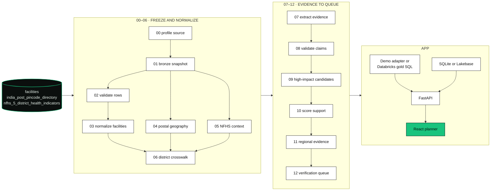
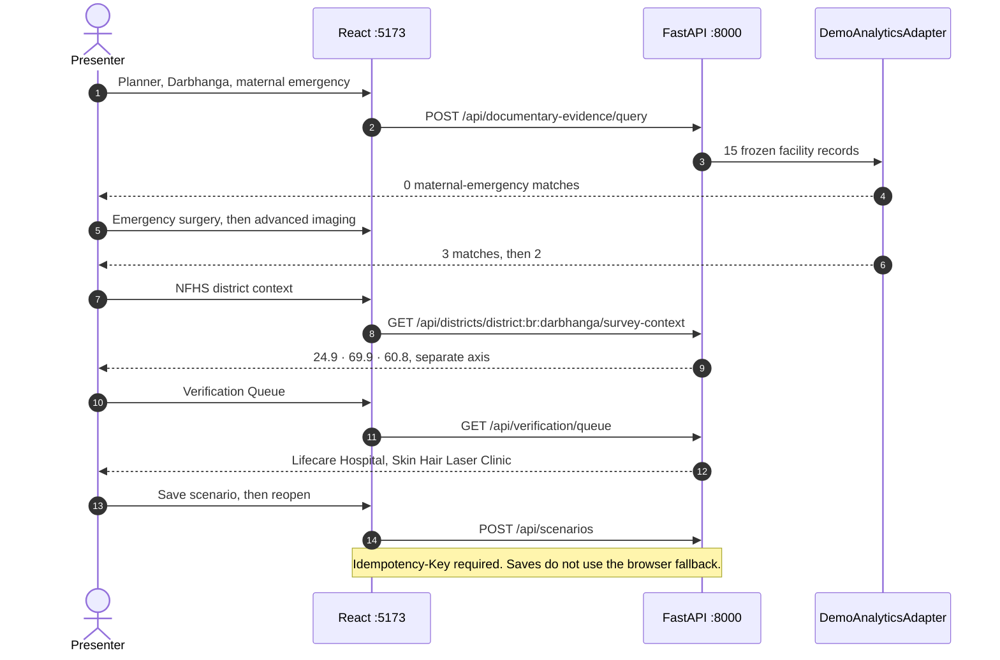

<p align="center">
  <strong>🏆 3rd place, Databricks Challenge track · Hack-Nation 6th Global AI Hackathon</strong>
</p>

<p align="center">
  <strong>Compare nearby facility documents with a district survey. Keep the two apart.</strong><br>
  <sub>Three capability policies, a 0–100 documentary score, and NFHS-5 on a separate axis. The local app serves a frozen Darbhanga adapter. Warehouse reads, Lakebase reviews, and the Unity Catalog pipeline run only when Databricks is enabled.</sub>
</p>

<p align="center">
  
  
  
  
  
  
  
</p>

---

## ▍The problem

A planner looking at a facility catalog cannot treat a row as "this hospital can do a C-section today." The text can be stale, attributed to the wrong place, or silent. Silence is not a measured absence of care. A district survey percentage is a different kind of number, and mixing the two produces a false gap.

Medical Desert Planner scores **documentary support** for three capability policies, shows NFHS-5 district indicators beside that score, and queues records whose PIN, city, and coordinates disagree. Every response carries a planning boundary: do not use the application for emergency dispatch, diagnosis, or confirmation of current service availability.

## ▍The pipeline at a glance

The shared source catalog is read-only: `databricks_virtue_foundation_dataset_dais_2026.virtue_foundation_dataset`. Stage 0 freezes a manifest and stops if the live tables drift from the committed contract.



| Stage | Id | What it does |
| --- | --- | --- |
| 00 | `profile_source` | Freeze the source manifest and profile |
| 01 | `snapshot_bronze` | Conserve every source row in bronze |
| 02 | `validate_facility_rows` | Classify quarantine and exact duplicates |
| 03 | `normalize_facilities` | Normalize canonical facility entities and fields |
| 04 | `build_postal_geography` | Validate offices and build PIN reference origins |
| 05 | `normalize_nfhs_context` | Parse NFHS observations and qualifiers |
| 06 | `build_district_crosswalk` | Deterministic state and district identity. Fuzzy matching is off |
| 07 | `extract_evidence` | Deterministic claims, evidence spans, and documents |
| 08 | `validate_claims` | Evidence and attribution validators |
| 09 | `verify_high_impact` | Publish bounded external-verification candidates |
| 10 | `score_documentary_support` | Capability-specific documentary support |
| 11 | `build_regional_evidence` | Distances, regional summaries, and survey profiles |
| 12 | `build_verification_queue` | Rank verification and planning-priority candidates |

`scripts/run_pipeline.py` renders that SQL. It executes against a warehouse only with `--execute`. The bundle job `recalculation` runs `all --bootstrap --execute`. Its weekly schedule is **paused**.

### Source contract

Expected shape in `pipelines/sql/00_profile_source.sql`. A mismatch is `drift_detected` and the stage asserts.

| Table | Grain | Expected rows | Expected columns |
| --- | --- | --- | --- |
| `facilities` | Extracted facility source row | 10,088 | 51 |
| `india_post_pincode_directory` | India Post office | 165,627 | 11 |
| `nfhs_5_district_health_indicators` | NFHS-5 state and district factsheet row | 706 | 109 |

`config/geography.yaml` expects 19,586 analysis origins from distinct source PINs: 19,550 mappable, 36 unavailable. Those origins are postal reference points. The config forbids the labels PIN centroid, population origin, and settlement center. District polygons and city selection stay off until a licensed boundary and a passed G1 city normalization exist.

### What a capability match requires

From `config/capabilities.yaml`. Default radius is 25 km. Allowed presets are 10, 25, and 50 km. The planner labels the radius as straight-line distance, not travel time.

| Capability | Both of these must appear |
| --- | --- |
| Maternal emergency documentation | Obstetrics and C-section |
| Emergency surgery documentation | Emergency medicine and general surgery |
| Advanced imaging documentation | CT and MRI |

### How a score becomes a label

`config/scoring.yaml` version `documentary-scoring-2026-07-19`. The index is the sum of six factors, clamped to 0–100.

| Factor | Max |
| --- | --- |
| Direct evidence specificity | 30 |
| Independent source corroboration | 20 |
| Source quality | 15 |
| Entity attribution quality | 15 |
| Freshness | 10 |
| Prerequisite support | 10 |

| Index | Band |
| --- | --- |
| ≥ 75 | Strongly supported |
| ≥ 50 | Partially supported |
| ≥ 25 | Claim only or weak |
| below 25 | Unsupported or very weak |
| no score | Insufficient evidence |

An unresolved contradiction caps the index at 49 and forces review. A confirmed contradiction forces the unsupported band. A facility counts as qualifying when it sits inside the selected radius, its band is strongly or partially supported, and the contradiction is not confirmed. A region with at least one qualifying facility and assessability at or above 0.65 is `strong_nearby_documentary_support`. Qualifying facilities without that assessability are `mixed_signal_verification_required`. Assessable silence is `low_nearby_documentary_support`. Otherwise the label is `insufficient_corpus_evidence`. NFHS values never enter this calculation.

The local demo stamps policy `capability-policy-2026-07-19` and scoring `documentary-scoring-2026-07-19`. The Databricks bundle variable `source_bundle_id` defaults to `virtue-dais-2026-20260719`, which is a different id from the demo bundle `virtue-dais-2026-profiled-2026-07-19`.

## ▍The demo

This repository has no committed screenshots. The show is the one-minute script in [demo/ONE_MINUTE_DEMO.md](demo/ONE_MINUTE_DEMO.md), played against the frozen Darbhanga adapter.

The UI opens on **Planner** for `district:br:darbhanga`. Three views: Planner, Scenarios, and Verification Queue (the Data Readiness Desk). The map is a local SVG outline. It requests no map tiles. Markers are postal reference points, and the results table is the non-map alternative. Facility Trust Desk sits beside the selection. NFHS district context is labeled **Separate context axis**.

| Clock | What you show |
| --- | --- |
| 0–10s | Darbhanga, Bihar. Say this is documentary planning support, not current services and not a medical desert. |
| 10–20s | 15 observed records. Maternal emergency: 0 policy matches. Low support or insufficient evidence, depending on assessability. |
| 20–30s | Emergency surgery: Darbhanga Medical College, Paras Global Darbhanga, R. B. Memorial Hospital. Advanced imaging: the first two only. |
| 30–40s | NFHS context `24.9`, `69.9`, `60.8`. Survey estimates. They do not change facility support. |
| 40–50s | Verification Queue. Lifecare Hospital (Siwan, longitude 84.3447, PIN 846001) or Skin Hair Laser Clinic (Purnea, longitude 87.4888, PIN 846004). PIN join says Darbhanga. City and coordinates disagree. Flagged and kept out of confident aggregation. |
| 50–60s | Save and reopen the scenario. Immutable snapshot, trace id, and an update-pending state. |

Those counts and the three NFHS figures are frozen in `fixtures/demo/darbhanga_demo_core.json` and `src/medical_desert/demo_data.py`.

| NFHS-5 indicator | Darbhanga value |
| --- | --- |
| Mothers with at least four antenatal care visits | 24.9 |
| Institutional births | 69.9 |
| Women age 15–49 with anaemia | 60.8 |

The demo fixture's classification is `planning_priority_candidate`. It forbids `medical_desert` and `confirmed_service_gap`. Referral Copilot is off and absent from the default navigation.



The nav footer reads **Single-team demo** and **Referral Copilot off**. Crisis overlay is a static "demo flood" banner in the client. `POST /api/crisis/analyze` stays disabled until `MEDICAL_DESERT_CRISIS_ENABLED=true`.

## ▍Run it

Requirements: Python 3.12, [uv](https://docs.astral.sh/uv/), Node.js 20 or newer, npm. Chromium is required for Playwright. No Databricks warehouse and no Tavily key are required for the local demo.

```sh
uv sync --all-groups
npm ci
npx playwright install chromium
```

CI uses `uv sync --all-groups --frozen` and `npx playwright install --with-deps chromium`.

Defaults in `src/medical_desert/config/settings.py` already select the local demo: Databricks off, Lakebase off, MLflow off, Tavily `cached`, referral off, crisis off, identity `single_team_demo`. Copy `.env.example` to `.env` when you need to override them. Do not put Databricks or Tavily credentials in `.env`, test output, traces, or commits.

Two processes. Vite proxies `/api` to the API.

```sh
uv run uvicorn medical_desert.api.main:app --host 127.0.0.1 --port 8000 --reload
npm run dev
```

| URL | What |
| --- | --- |
| http://127.0.0.1:5173 | Planner, scenarios, verification queue |
| http://127.0.0.1:8000/api/health | API health |
| http://127.0.0.1:8000/docs | OpenAPI |

**No key needed to run the demo.** The API uses `DemoAnalyticsAdapter` unless `MEDICAL_DESERT_DATABRICKS_ENABLED=true`. Frontend read fallback is off. Set `VITE_DEMO_FALLBACK=true` only for an explicit offline UI. With that flag, failed reads use `frontend/src/demoData.ts`. Scenario listing falls back to those bundled scenarios, or to `localStorage` key `careaxiom-scenarios-v1` when that key is already set. This client does not write the key. Scenario saves and verification decisions always call the API.

### Tests

Offline G0–G7 suite, the same marker expression CI uses:

```sh
uv run pytest -m "not connected and not e2e"
npm test
npx playwright test
```

Playwright starts the API on port 8000 and the frontend on port 5173, then runs Chromium desktop and Pixel 7 projects. Coverage, matching CI:

```sh
uv run pytest -m "not connected and not e2e" \
  --cov=medical_desert \
  --cov-report=term-missing \
  --cov-report=html:reports/coverage
```

Fixture hashes live in `fixtures/manifest.sha256`.

```sh
uv run pytest tests/test_fixture_manifest.py
```

Connected catalog checks stay out of the default run. They need `DATABRICKS_SERVER_HOSTNAME`, `DATABRICKS_HTTP_PATH`, and `DATABRICKS_TOKEN`. Leave the values in the shell. Do not commit them.

```sh
uv run pytest -m connected
```

`CAREAXIOM_APP` is an optional test override for the FastAPI import path. The default candidate is `medical_desert.api.main:app`.

### Render the pipeline

Dry run writes SQL under `.dist/rendered-sql` and does not touch a warehouse:

```sh
uv run python scripts/run_pipeline.py all
uv run python scripts/run_pipeline.py 0-6
```

`--execute` runs the rendered statements. `--bootstrap` includes `sql/unity_catalog_tables.sql`. That is the recalculation job, not the local demo. See [docs/deployment.md](docs/deployment.md).

### Package the Databricks App

```sh
uv run python scripts/package_app.py
uv run python scripts/validate_artifact.py
```

The artifact is `.dist/react-app`. It excludes tests, fixtures, the source `frontend/` tree, local databases, and credentials. Pipeline code syncs separately for the job.

Deploy is manual. Supply the existing warehouse, Lakebase, project catalog, and secret scope, then:

```sh
databricks bundle validate -t prod --profile careaxiom
databricks bundle deploy -t prod --profile careaxiom
databricks bundle run recalculation -t prod --profile careaxiom
databricks bundle run medical_desert_planner -t prod --profile careaxiom
```

`bundle deploy` does not restart the app. The last `bundle run` does. `.github/workflows/deploy.yml` is a protected manual workflow that packages, validates, deploys, runs the pipeline, restarts, and polls health. Keep Tavily `cached` unless a deployed egress canary has passed.

Bundle variables: `project_catalog`, `sql_warehouse_id`, `sql_warehouse_http_path`, `lakebase_branch`, `lakebase_database`, `lakebase_host`, `lakebase_database_name`, `tavily_secret_scope`, `app_access_group`.

App settings use the `MEDICAL_DESERT_` prefix. `TAVILY_API_KEY` is the one unprefixed alias. The production app resource enables Databricks SQL and Lakebase, binds an MLflow experiment, and sets `MEDICAL_DESERT_MLFLOW_ENABLED=false` and Tavily to `cached`. Health then reports tracing as disabled. [docs/deployment.md](docs/deployment.md) still lists a healthy MLflow trace write among the checks.

## ▍Repository map

```
CareAxiom/
├── src/medical_desert/
│   ├── api/main.py                 FastAPI routes, static app mount
│   ├── application/services.py     queries, scenarios, review, exports
│   ├── adapters/                   demo analytics, Databricks SQL, Tavily, MLflow
│   ├── scoring/engine.py           index, bands, assessability, region class
│   ├── demo_data.py                frozen Darbhanga facilities and NFHS context
│   ├── persistence/                SQLite locally, Lakebase when enabled
│   └── orchestration/              stage registry and SQL runner
├── frontend/                       React planner, Vite, Vitest
├── pipelines/sql/                  stages 00–12
├── scripts/                        run_pipeline.py, package_app.py, validate_artifact.py
├── sql/                            Unity Catalog DDL, Lakebase schema, grants
├── config/                         capabilities, scoring, geography, validators
├── fixtures/                       contract and demo JSON, manifest.sha256
├── tests/                          unit, api, integration, connected, e2e
├── resources/                      Databricks bundle app, job, experiments
├── databricks.yml                  bundle variables and targets
└── demo/ONE_MINUTE_DEMO.md         presenter script
```

| Doc | |
| --- | --- |
| [demo/ONE_MINUTE_DEMO.md](demo/ONE_MINUTE_DEMO.md) | 60-second Darbhanga script |
| [docs/deployment.md](docs/deployment.md) | Warehouse, Lakebase, grants, health, rollback |
| [docs/test-strategy.md](docs/test-strategy.md) | G0–G7 gates and fixture rules |
| [deploy/README.md](deploy/README.md) | What the App artifact includes and excludes |

## ▍What this is, and isn't

We'd rather be precise than impressive.

- The product returns a documentary-support label. The demo fixture forbids `medical_desert` and `confirmed_service_gap`. The planning boundary on every response says the same thing: incomplete or stale facility text is not current availability.
- Local runs serve 15 frozen Darbhanga records from `DemoAnalyticsAdapter`. They do not query the 10,088-row facility contract.
- NFHS-5 is district survey context. Sample counts are not population denominators. The indicators do not change a facility score or a regional class.
- PIN, city, and coordinate disagreements stay reviewable and out of confident distance aggregation until someone resolves them. Lifecare Hospital and Skin Hair Laser Clinic are the demo cases.
- The map is a schematic SVG with no external tiles. Versioned district boundaries are disabled. City selection is disabled. Radius is straight-line distance.
- Referral Copilot is off. The `/api/referral/shortlist` route is registered only when `MEDICAL_DESERT_REFERRAL_ENABLED=true`.
- The crisis button draws a static demo flood overlay. The crisis API returns 404 until `MEDICAL_DESERT_CRISIS_ENABLED=true`.
- Tavily defaults to `cached`. Cached mode makes no live request. The deploy docs keep it cached until an egress canary passes.
- Identity defaults to one fixed demo actor, `demo-planner`. That mode does not claim multi-user isolation.
- The recalculation job's cron is paused. Rendering SQL is local. Executing it needs a warehouse and is a separate step.
- The App resource binds an MLflow experiment and sets tracing off.

## ▍Credits

| | |
| --- | --- |
| Application | CareAxiom Medical Desert Planner |
| Facility, PIN, and NFHS-5 tables | Read-only catalog `databricks_virtue_foundation_dataset_dais_2026.virtue_foundation_dataset` |
| Survey context | NFHS-5 district factsheet rows, kept off the facility score |
| Postal reference | India Post PIN directory in that catalog. Medians are reference points, not centroids |
| External verification | Tavily, cached unless `MEDICAL_DESERT_TAVILY_MODE` is live |
| Warehouse, catalog, operational store, app host | Databricks SQL, Unity Catalog, Lakebase, Databricks Apps |
| API and UI | FastAPI, React, Vite |

<p align="center">
  <sub>Hack-Nation 6th Global AI Hackathon · Databricks Challenge track.</sub>
</p>
