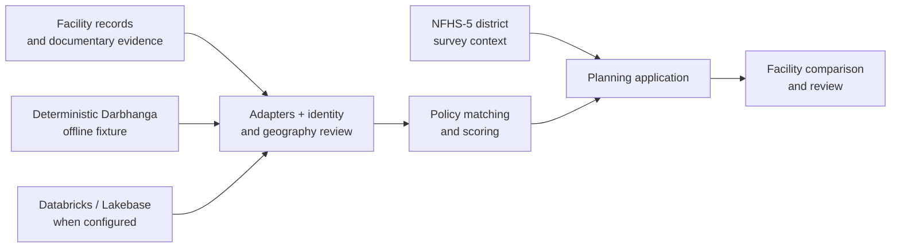

<h1 align="center">CareAxiom</h1>
<p align="center">🏆 <b>3rd place · Databricks “Data Legend” challenge</b><br/><sub>Hack-Nation 6th Global AI Hackathon · <a href="https://www.linkedin.com/company/hack-nation">Organizer's winners announcement</a></sub></p>
<p align="center"><b>Turn fragmented facility evidence into a planning view with uncertainty left visible.</b><br/><sub>Documentary support + separately presented district survey context</sub></p>

<p align="center">
  
  
  
  
</p>

## ▍Project gallery

<table><tr>
<td width="50%"></td>
<td width="50%"></td>
</tr></table>

<sub>Images from the [project portfolio](https://bede-lau.github.io/); they may depict an earlier build.</sub>


## ▍The question

How can a planner compare nearby facilities without mistaking a document, a survey statistic, or a geographic match for proof that a service is currently available? CareAxiom's Medical Desert Planner brings those evidence streams together while keeping their limits explicit.

## ▍Evidence flow



| Evidence | What it can establish | What it cannot establish alone |
| --- | --- | --- |
| Facility documents | Documentary support for a policy match | Current service availability or capacity |
| NFHS-5 district context | District-level survey context | Conditions at an individual facility |
| Geography and identity | A reviewable basis for matching | A confident match when records conflict |

The offline fixture includes 15 facility records and keeps two high-priority geography conflicts out of confident aggregation pending review. The app does **not** establish that an area is a medical desert.

---

Medical Desert Planner is an evidence-grounded planning application for comparing nearby facility documentary support with separately presented NFHS-5 district survey context. It does not confirm current service availability, capacity, or a medical desert.

## ▍From source rows to a reviewable decision

| Stage | Repository path | Purpose |
| --- | --- | --- |
| Profile and preserve | [`pipelines/00_profile_source.py`](pipelines/00_profile_source.py), [`01_snapshot_bronze.py`](pipelines/01_snapshot_bronze.py) | Profile source records and preserve a bronze snapshot. |
| Normalize and locate | `pipelines/02_*.py`–`06_*.py` | Validate facility rows, normalize records and build postal/district geography and survey context. |
| Extract and verify | `pipelines/07_*.py`–`09_*.py` | Extract evidence, validate claims and review high-impact information. |
| Score and queue | `pipelines/10_*.py`–`12_*.py` | Compute documentary support, regional evidence and a verification queue. |
| Review and save | [`src/medical_desert/`](src/medical_desert/), [`frontend/`](frontend/) | Serve the planner, review flows and saved scenarios. |

### What the checks protect

The [G0–G7 test strategy](docs/test-strategy.md) covers fixture hashes, geography conflicts, scoring, immutable scenario history, audit/outbox behavior and browser workflows. The NFHS district values remain context: they do not change a facility's documentary support score. A missing number is not silently converted into zero, and a parse failure is not treated as an empty record.

Connected Databricks checks are separate from the default offline tests. The committed fixture values below are a reproducible demo contract, not an accuracy estimate for live healthcare data.

---


## Prerequisites

- Python 3.12
- `uv`
- Node.js 20 or newer
- npm
- Chromium for Playwright browser tests

## Setup

Install the declared application and development dependencies:

```powershell
uv sync --all-groups
npm ci
npx playwright install chromium
```

Do not add Databricks or Tavily credentials to `.env`, test output, traces, or committed files.

## Run Locally

Start the API and frontend in separate terminals:

```powershell
$env:CAREAXIOM_APP = "medical_desert.api.main:app"
uv run uvicorn medical_desert.api.main:app --reload
npm run dev
```

The local API uses the deterministic Darbhanga adapter unless Databricks is enabled.
Frontend read fallback is disabled by default; set `VITE_DEMO_FALLBACK=true` only for an
explicit offline UI demonstration. Writes never fall back to browser-local state.

## Test

Run the offline G0-G7 suite:

```powershell
uv run pytest -m "not connected and not e2e"
```

Run coverage:

```powershell
uv run pytest `
  -m "not connected and not e2e" `
  --cov=medical_desert `
  --cov-report=term-missing `
  --cov-report=html:reports/coverage
```

Run connected catalog contracts only when credentials are explicitly available:

```powershell
$env:DATABRICKS_SERVER_HOSTNAME = "dbc-..."
$env:DATABRICKS_HTTP_PATH = "/sql/1.0/warehouses/..."
$env:DATABRICKS_TOKEN = "..."
uv run pytest -m connected
```

Run browser verification. Playwright starts both the API and frontend:

```powershell
npx playwright test
```

## Fixture Integrity

Offline fixtures live in `fixtures/contracts` and `fixtures/demo`. `fixtures/manifest.sha256` records every JSON fixture hash.

Verify the manifest:

```powershell
uv run pytest tests/test_fixture_manifest.py
```

The Darbhanga fixture freezes:

- 15 observed facility records.
- 0 maternal-emergency policy matches.
- 3 emergency-surgery policy matches.
- 2 advanced-imaging policy matches.
- NFHS context values `24.9`, `69.9`, and `60.8`.
- Lifecare Hospital and Skin Hair Laser Clinic as high-priority geography conflicts excluded from confident aggregation pending review.

## Deploy

1. Run the offline pytest suite, frontend tests, frontend build, and Playwright suite.
2. Confirm Referral Copilot is disabled and absent from default navigation.
3. Build and validate the exact Databricks App artifact with `scripts/package_app.py`.
4. Supply the existing warehouse, Lakebase, project catalog, and secret-scope bundle variables.
5. Deploy the bundle, run `recalculation`, then run `medical_desert_planner` to restart the app.
6. Keep Tavily cached-only unless the deployed egress canary passes.
7. Verify `/api/health`, warm SQL and Lakebase, and rehearse the one-minute flow.

See [Deployment](docs/deployment.md), [Test Strategy](docs/test-strategy.md), and [One-Minute Demo](demo/ONE_MINUTE_DEMO.md).
